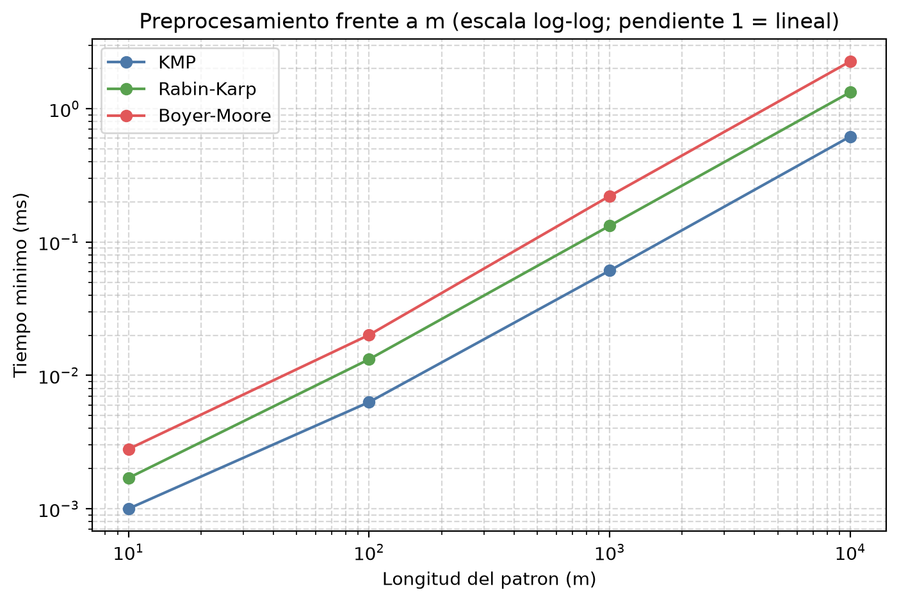
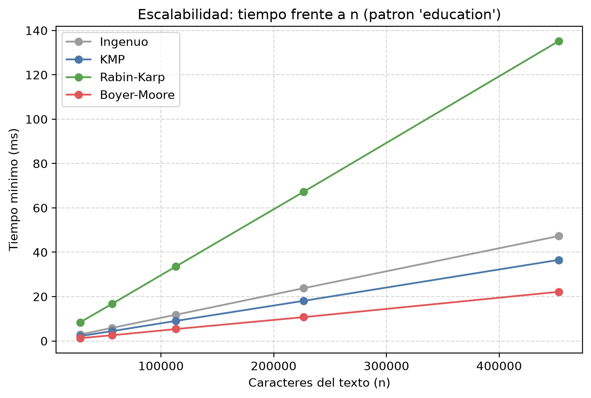
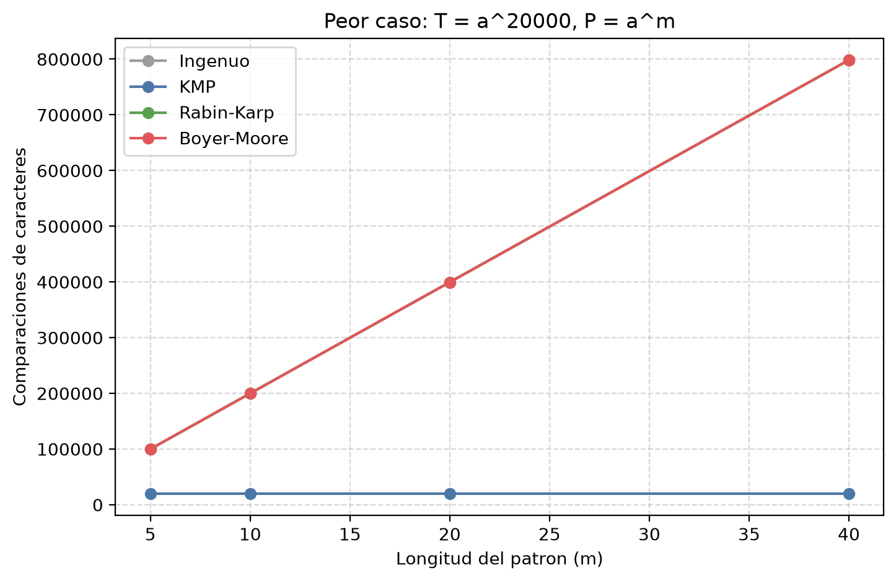

# Análisis Crítico — Búsqueda de Patrones (Requerimiento 3)

Este documento compara formalmente KMP, Rabin-Karp y Boyer-Moore según su
complejidad asintótica teórica, separando el costo del **preprocesamiento**
del patrón del costo de la **búsqueda** en el texto, y contrasta ese análisis
con el rendimiento medido al ejecutar las implementaciones de
`src/busqueda/` sobre los 20 abstracts del corpus (tarea BUS-5). El caso de
estudio paso a paso de los tres algoritmos está en
`caso_estudio_busqueda.md`.

Todos los números de las secciones 4 y 5 se reproducen con:

```
.\venv\Scripts\python.exe src\busqueda\comparacion_busqueda.py
```

que guarda los resultados en `data/resultados/busqueda.json` y los gráficos
en `docs/busqueda/`.

**Notación.** $n$: longitud del texto; $m$: longitud del patrón; $\sigma$:
tamaño del alfabeto; $q$: módulo de Rabin-Karp; $v$: número de ocurrencias
del patrón en el texto.

---

## 1. Complejidad teórica

### 1.1 Resumen

| Algoritmo | Preprocesamiento | Memoria adicional | Búsqueda: mejor caso | Búsqueda: caso esperado | Búsqueda: peor caso |
|---|---|---|---|---|---|
| Ingenuo (referencia) | — | $O(1)$ | $\Theta(n)$ | $\Theta(n)$ en texto natural | $\Theta((n-m+1)\,m)$ |
| KMP | $\Theta(m)$ | $\Theta(m)$ | $\Theta(n)$ | $\Theta(n)$ | $\Theta(n)$, a lo sumo $2n$ comparaciones |
| Rabin-Karp | $\Theta(m)$ | $O(1)$ | $\Theta(n)$ | $O(n + m + v\,m)$ | $\Theta((n-m+1)\,m)$ |
| Boyer-Moore (carácter malo + sufijo bueno fuerte) | $\Theta(m)$ (con diccionario; $\Theta(m + \sigma)$ con arreglo) | $\Theta(m)$ | $\Theta(n/m)$ | sublineal, del orden de $n/m$ comparaciones si $\sigma \gg m$ | $\Theta(n)$ si $v = 0$; $\Theta((n-m+1)\,m)$ con muchas ocurrencias |

Las cotas de los tres algoritmos del R3 siguen a Cormen et al. (2022,
cap. 32), Knuth, Morris y Pratt (1977), Karp y Rabin (1987) y Boyer y Moore
(1977); la cota de $3n$ comparaciones de Boyer-Moore sin ocurrencias es de
Cole (1994), y la regla que elimina el peor caso con ocurrencias es de Galil
(1979).

### 1.2 Knuth-Morris-Pratt

**Preprocesamiento $\Theta(m)$.** `tabla_prefijos` recorre el patrón una vez.
El ciclo interno solo hace bajar $k$, y $k$ sube a lo sumo una unidad por
cada $q$; por análisis amortizado, el total de iteraciones del ciclo
interno no supera $m - 1$, así que se hacen menos de $2(m-1)$ comparaciones.
La tabla $\pi$ ocupa $\Theta(m)$.

**Búsqueda $\Theta(n)$.** El mismo argumento sobre $q$: cada comparación o
avanza el índice $i$ del texto (a lo sumo $n$ veces) o hace bajar $q$, que
no puede bajar más veces de las que subió (a lo sumo $n$). Por tanto se
hacen como máximo $2n$ comparaciones **para cualquier texto y patrón**: KMP
no tiene un peor caso distinto del caso promedio y nunca retrocede en el
texto. Total: $\Theta(n + m)$.

### 1.3 Rabin-Karp

**Preprocesamiento $\Theta(m)$.** Tres cálculos de $m$ pasos: el hash del
patrón y el de la primera ventana por la regla de Horner, y
$h = d^{\,m-1} \bmod q$ con `potencia_modular`, que multiplica $m - 1$ veces
(con exponenciación binaria sería $O(\log m)$, pero el término $\Theta(m)$
de los hashes domina igual). Memoria $O(1)$.

**Búsqueda.** Hay $n - m + 1$ ventanas y cada actualización del rolling hash
es $O(1)$, lo que da $\Theta(n)$ operaciones aritméticas siempre. A eso se
suman $O(m)$ comparaciones por cada ventana cuyo hash coincide con el del
patrón: las $v$ ocurrencias reales más las colisiones. Si el hash se
comporta como una función uniforme, se esperan unas $(n - m + 1)/q$
colisiones, y el tiempo esperado es $O(n + m + v\,m + (n-m+1)\,m/q)$, que
con $q \ge m$ grande se reduce a $O(n + m + v\,m)$. En el peor caso, todas
las ventanas coinciden en hash (por ocurrencias reales o por colisiones) y
el tiempo es $\Theta((n-m+1)\,m)$, igual al ingenuo.

### 1.4 Boyer-Moore

**Preprocesamiento $\Theta(m)$.** La tabla del carácter malo es un
recorrido del patrón; como se guarda en un diccionario de Python, cuesta
$\Theta(m)$ en vez del $\Theta(m + \sigma)$ de un arreglo indexado por
carácter. La tabla del sufijo bueno (regla fuerte) se calcula en
$\Theta(m)$ con el arreglo de bordes `f`, con un argumento amortizado
análogo al de KMP. Son dos tablas y dos recorridos, así que su constante es
la mayor de los tres algoritmos.

**Búsqueda.** El patrón se compara de derecha a izquierda y se desplaza
según el mayor de los dos saltos.

* *Mejor caso* $\Theta(n/m)$: cada alineación falla en la primera
  comparación con un carácter ausente del patrón y el salto es $m$.
* *Caso esperado*: en texto natural, con alfabeto grande frente a $m$, la
  mayoría de las alineaciones fallan pronto y saltan cerca de $m$; el número
  de comparaciones es sublineal y disminuye al crecer $m$.
* *Peor caso*: sin ocurrencias, la regla fuerte del sufijo bueno garantiza
  $O(n)$ (como máximo $3n$ comparaciones, Cole, 1994). Con muchas
  ocurrencias, la implementación (que no incluye la regla de Galil) vuelve a
  comparar caracteres ya verificados y llega a $\Theta((n-m+1)\,m)$; por
  ejemplo, con $T = a^n$ y $P = a^m$, cada alineación hace $m$
  comparaciones y el salto tras una ocurrencia es `tabla_bueno[0] = 1`.

### 1.5 Preprocesamiento frente a búsqueda

Los tres algoritmos invierten $\Theta(m)$ en preprocesar el patrón para
reducir el trabajo sobre el texto, pero lo que compran es distinto: KMP
compra una **garantía** de $2n$ comparaciones; Rabin-Karp, la posibilidad
de descartar una ventana con **una comparación de enteros** en lugar de $m$
de caracteres; Boyer-Moore, la posibilidad de **no leer** parte del texto.
En este proyecto $m \ll n$: los patrones tienen entre 2 y 34 caracteres y
cada abstract entre 906 y 1.822 (28.284 en total), así que en teoría el
preprocesamiento debería ser despreciable frente a la búsqueda. La
sección 4.3 muestra cuándo esto deja de ser cierto.

---

## 2. Metodología experimental

* **Implementaciones medidas:** las funciones `buscar_con_estadisticas` de
  `kmp.py`, `rabin_karp.py` ($d = 256$, $q = 1\,000\,000\,007$) y
  `boyer_moore.py`, más el **algoritmo ingenuo** (fuerza bruta) como línea
  base: prueba cada una de las $n - m + 1$ posiciones del texto y compara el
  patrón de izquierda a derecha hasta el primer fallo, sin preprocesamiento
  ni saltos. No forma parte del R3; está escrito en el mismo script solo
  para tener una referencia contra la cual medir lo que aporta cada
  algoritmo. Las cuatro implementaciones cuentan comparaciones de
  caracteres, de modo que el costo de ese contador afecta a todas por igual.
* **Equipo:** los tiempos reportados se midieron en el computador de uno de
  los integrantes; solo son comparables entre sí.
* **Texto:** el `abstract` original de cada artículo, distinguiendo
  mayúsculas (criterio de `caso_estudio_busqueda.md`, sección 1.1).
* **Reloj y repeticiones:** `time.perf_counter()`, 3 ejecuciones de
  calentamiento no contabilizadas y algoritmos **alternados** en cada
  repetición (30 repeticiones en el corpus, 200 para el preprocesamiento,
  10 en escalabilidad y peores casos), igual que en el seguimiento. Se
  reportan el mínimo, el promedio y la desviación estándar; el análisis usa
  el **mínimo**, la medida menos afectada por interrupciones del sistema
  operativo.
* **Separación de fases:** cada llamada a `buscar` reconstruye las tablas
  del patrón, así que buscar en los 20 abstracts preprocesa 20 veces. El
  preprocesamiento se mide aparte (llamando solo a las funciones que
  construyen las estructuras auxiliares) y el tiempo de búsqueda se estima
  como $\text{total} - 20 \times \text{preprocesamiento}$.
* **Medida independiente del equipo:** además del tiempo se reportan las
  comparaciones de caracteres. Para Rabin-Karp esa cifra solo cuenta las
  verificaciones; su trabajo principal son las $n - m + 1$ actualizaciones
  del hash.
* **Validación:** antes de medir, el script comprueba que los cuatro
  algoritmos encuentran exactamente las mismas ocurrencias para cada patrón.

---

## 3. Resultados

### 3.1 Preprocesamiento frente a $m$

Patrones aleatorios de letras minúsculas y espacios, tiempo mínimo en
milisegundos:

| $m$ | KMP | Rabin-Karp | Boyer-Moore |
|---:|---:|---:|---:|
| 10 | 0,0010 | 0,0017 | 0,0028 |
| 100 | 0,0063 | 0,0132 | 0,0201 |
| 1.000 | 0,0611 | 0,1324 | 0,2214 |
| 10.000 | 0,6188 | 1,3301 | 2,2644 |



A partir de $m = 100$, multiplicar $m$ por 10 multiplica el tiempo por
≈ 10 en los tres algoritmos (pendiente 1 en la escala log-log): el
preprocesamiento es **lineal en $m$**, como predice la teoría. Las
constantes difieren: Rabin-Karp cuesta unas 2,1 veces lo de KMP (tres
recorridos con aritmética modular) y Boyer-Moore unas 3,7 veces (dos tablas,
una de ellas un diccionario). Con $m = 10$ el tiempo está dominado por el
costo fijo de llamar a la función.

### 3.2 Búsqueda en los 20 abstracts

Ocho patrones de distinta longitud, uno de ellos ausente del corpus
(`blockchain`). Comparaciones de caracteres en los 28.284 caracteres del
corpus:

| Patrón | $m$ | Ocurrencias | Ingenuo | KMP | Rabin-Karp (verificaciones) | Boyer-Moore |
|---|---:|---:|---:|---:|---:|---:|
| `AI` | 2 | 143 | 28.466 | 28.343 | 286 | 14.343 |
| `data` | 4 | 7 | 29.248 | 29.272 | 28 | 8.122 |
| `learning` | 8 | 37 | 29.497 | 29.206 | 296 | 4.895 |
| `education` | 9 | 78 | 31.796 | 31.107 | 702 | 5.364 |
| `assessment` | 10 | 35 | 30.320 | 30.088 | 350 | 4.165 |
| `blockchain` | 10 | 0 | 28.336 | 28.478 | 0 | 3.833 |
| `artificial intelligence` | 23 | 11 | 30.136 | 30.101 | 253 | 2.460 |
| `generative artificial intelligence` | 34 | 3 | 28.467 | 28.804 | 102 | 1.962 |

Tiempo mínimo total (preprocesamiento incluido) de buscar en los 20
abstracts, en milisegundos:

| Patrón | $m$ | Ingenuo | KMP | Rabin-Karp | Boyer-Moore |
|---|---:|---:|---:|---:|---:|
| `AI` | 2 | 2,560 | **1,878** | 6,261 | 4,136 |
| `data` | 4 | 2,573 | **1,980** | 7,608 | 2,259 |
| `learning` | 8 | 2,613 | 1,965 | 8,132 | **1,324** |
| `education` | 9 | 2,789 | 2,240 | 8,219 | **1,305** |
| `assessment` | 10 | 2,672 | 2,076 | 8,079 | **1,118** |
| `blockchain` | 10 | 2,492 | 1,879 | 8,013 | **1,022** |
| `artificial intelligence` | 23 | 2,636 | 2,072 | 8,084 | **0,699** |
| `generative artificial intelligence` | 34 | 2,497 | 1,965 | 7,983 | **0,625** |


Los promedios siguen el mismo orden. Las desviaciones estándar van del 2 %
al 27 % del promedio, con una excepción: Boyer-Moore con `AI` tuvo un
promedio de 8,44 ms y una desviación de 12,54 ms porque una repetición
aislada se vio interrumpida por el sistema operativo; su mínimo (4,14 ms) no
se ve afectado, y por eso el análisis usa el mínimo. Todos los valores están
en `data/resultados/busqueda.json`.

### 3.3 Peso del preprocesamiento en el tiempo total

Tiempo de preprocesar el patrón 20 veces (una por abstract) y porcentaje
que representa del tiempo total de la tabla anterior:

| Patrón | $m$ | KMP | Rabin-Karp | Boyer-Moore |
|---|---:|---:|---:|---:|
| `AI` | 2 | 0,0100 ms (0,5 %) | 0,0120 ms (0,2 %) | 0,0240 ms (0,6 %) |
| `data` | 4 | 0,0120 ms (0,6 %) | 0,0180 ms (0,2 %) | 0,0340 ms (1,5 %) |
| `learning` | 8 | 0,0160 ms (0,8 %) | 0,0280 ms (0,3 %) | 0,0480 ms (3,6 %) |
| `education` | 9 | 0,0180 ms (0,8 %) | 0,0300 ms (0,4 %) | 0,0500 ms (3,8 %) |
| `assessment` | 10 | 0,0180 ms (0,9 %) | 0,0340 ms (0,4 %) | 0,0560 ms (5,0 %) |
| `blockchain` | 10 | 0,0180 ms (1,0 %) | 0,0320 ms (0,4 %) | 0,0540 ms (5,3 %) |
| `artificial intelligence` | 23 | 0,0360 ms (1,7 %) | 0,0680 ms (0,8 %) | 0,1100 ms (15,7 %) |
| `generative artificial intelligence` | 34 | 0,0460 ms (2,3 %) | 0,0940 ms (1,2 %) | 0,1480 ms (23,7 %) |

### 3.4 Escalabilidad frente a $n$

Los 20 abstracts concatenados y repetidos 1, 2, 4, 8 y 16 veces, patrón
`education`, tiempo mínimo:

| $n$ | Ingenuo (ms) | KMP (ms) | Rabin-Karp (ms) | Boyer-Moore (ms) | µs por carácter (I / K / RK / BM) |
|---:|---:|---:|---:|---:|---|
| 28.303 | 2,89 | 2,19 | 8,40 | 1,27 | 0,102 / 0,077 / 0,297 / 0,045 |
| 56.607 | 5,88 | 4,41 | 16,71 | 2,55 | 0,104 / 0,078 / 0,295 / 0,045 |
| 113.215 | 11,80 | 9,03 | 33,58 | 5,36 | 0,104 / 0,080 / 0,297 / 0,047 |
| 226.431 | 23,76 | 18,07 | 67,20 | 10,72 | 0,105 / 0,080 / 0,297 / 0,047 |
| 452.863 | 47,29 | 36,54 | 135,19 | 22,16 | 0,104 / 0,081 / 0,299 / 0,049 |



Las comparaciones por carácter también se mantienen constantes con $n$:
1,130 (ingenuo), 1,100 (KMP), 0,025 (Rabin-Karp) y 0,190 (Boyer-Moore).

### 3.5 Peores casos

Texto $T = a^{20000}$. Comparaciones de caracteres / tiempo mínimo (ms):

| Patrón | $m$ | Ingenuo | KMP | Rabin-Karp | Boyer-Moore |
|---|---:|---:|---:|---:|---:|
| $a^m$ | 5 | 99.980 / 8,74 | 20.000 / 2,89 | 99.980 / 19,05 | 99.980 / 12,43 |
| $a^m$ | 10 | 199.910 / 17,60 | 20.000 / 2,94 | 199.910 / 29,86 | 199.910 / 24,26 |
| $a^m$ | 20 | 399.620 / 31,63 | 20.000 / 2,85 | 399.620 / 47,36 | 399.620 / 43,66 |
| $a^m$ | 40 | 798.440 / 62,41 | 20.000 / 2,89 | 798.440 / 84,87 | 798.440 / 83,93 |
| $b\,a^{m-1}$ | 5 | 19.996 / 1,83 | 20.000 / 1,33 | 0 / 5,64 | 20.000 / 2,87 |
| $b\,a^{m-1}$ | 40 | 19.961 / 1,80 | 20.000 / 1,31 | 0 / 5,58 | 20.000 / 2,11 |

(Las filas de $b\,a^{m-1}$ con $m = 10$ y $m = 20$ dan los mismos conteos y
están en el JSON.)



Con $P = a^m$ cada una de las $n - m + 1$ ventanas es una ocurrencia.
Ingenuo, Rabin-Karp y Boyer-Moore hacen exactamente $(n-m+1)\,m$
comparaciones (por ejemplo, $19.961 \times 40 = 798.440$): el número crece
linealmente con $m$ y el tiempo con él. KMP hace exactamente $n = 20.000$
para cualquier $m$, y su tiempo no cambia.

### 3.6 Efecto del módulo $q$ en Rabin-Karp

Sobre los 20 abstracts:

| Patrón | $q$ | Colisiones medidas | Colisiones esperadas $\approx (n-m+1)/q$ | Comparaciones | Tiempo mínimo (ms) |
|---|---:|---:|---:|---:|---:|
| `education` | 13 | 2.086 | 2.163 | 2.994 | 6,77 |
| `education` | 101 | 300 | 278 | 1.024 | 6,21 |
| `education` | 1.000.000.007 | 0 | 0,00003 | 702 | 8,17 |
| `learning` | 13 | 2.194 | 2.165 | 2.552 | 6,85 |
| `learning` | 101 | 279 | 279 | 581 | 6,21 |
| `learning` | 1.000.000.007 | 0 | 0,00003 | 296 | 8,04 |
| `AI` | 13 | 3.004 | 2.174 | 3.298 | 7,05 |
| `AI` | 101 | 260 | 280 | 546 | 6,29 |
| `AI` | 1.000.000.007 | 0 | 0,00003 | 286 | 6,18 |

---

## 4. Contraste entre la teoría y lo observado

**La linealidad se confirma en los tres algoritmos.** Con $n$ multiplicado
por 16, el tiempo por carácter de cada algoritmo varía menos del 9 %
(sección 3.4), y las comparaciones por carácter son constantes. El
preprocesamiento también es lineal en $m$ (sección 3.1). Hasta aquí la
notación asintótica predice bien el comportamiento; lo que no predice es el
orden entre algoritmos, que depende de las constantes.

**Rabin-Karp: menos comparaciones, más tiempo.** Es el algoritmo que menos
caracteres compara (0,025 por carácter del texto con `education`) y, sin
embargo, el más lento: entre 3,3 y 4,3 veces el tiempo de KMP. La cifra de comparaciones
oculta su trabajo real: en cada una de las $n - m + 1$ ventanas hace una
multiplicación, una resta, una suma y un módulo, frente a una comparación de
caracteres en KMP. Las dos cosas son $\Theta(n)$, pero la constante de
Rabin-Karp es mayor. Un detalle lo confirma: con $q = 101$ el algoritmo es
**más rápido** que con $q = 10^9 + 7$ (6,21 frente a 8,17 ms con
`education`) aunque hace 300
verificaciones adicionales. La explicación probable es que con un módulo
grande los productos intermedios ($256 \cdot v \cdot h$, del orden de
$10^{13}$) superan el tamaño de entero que Python opera con un solo dígito
interno ($2^{30}$), y la aritmética se encarece; con `AI` ($m = 2$,
$h = 256$) los números son pequeños incluso con el primo grande y ese es el
tiempo más bajo de su grupo (6,18 ms). Las colisiones, en cambio, se comportan como predice la
teoría: el número medido está cerca de $(n - m + 1)/q$ para `education` y
`learning`; con `AI` y $q = 13$ hay más de las esperadas porque con $m = 2$
el hash es $(9\,v_0 + v_1) \bmod 13$ y las letras del inglés no se reparten
de forma uniforme entre los 13 residuos.

**KMP frente al ingenuo: la ventaja es la garantía, no el caso típico.** En
el corpus, KMP y el ingenuo comparan casi lo mismo (entre 1,00 y 1,12
comparaciones por carácter): en texto natural el patrón rara vez coincide
más de uno o dos caracteres seguidos, así que el ingenuo casi nunca
retrocede. KMP tarda entre un 20 y un 27 % menos por la forma del ciclo, no por hacer
menos trabajo. La diferencia teórica aparece en la sección 3.5: con
$P = a^{40}$ el ingenuo hace 798.440 comparaciones y KMP 20.000. KMP es el
único de los cuatro cuyo costo no depende del contenido del texto.

**Boyer-Moore: sublineal en la práctica.** Es el único que hace menos de una
comparación por carácter, y la proporción baja al crecer el patrón: 0,51
con $m = 2$, 0,19 con $m = 9$ y 0,07 con $m = 34$ (aproximadamente
$c/m$, con $c$ entre 1 y 2,4). Es el comportamiento esperado: cuanto más
largo el patrón, más largos los saltos. Su tiempo sigue la misma tendencia
(de 4,14 ms a 0,63 ms) y desde $m = 8$ es el más rápido; con `generative
artificial intelligence` es 3,1 veces más rápido que KMP. Con `AI`
($m = 2$) es más lento que KMP y que el ingenuo: los saltos son de 1 o 2
posiciones y el costo por alineación (consultar dos tablas, una de ellas un
diccionario) no se compensa. En el peor caso con ocurrencias ($a^m$) se
comporta como el ingenuo, tal como predice la teoría para una
implementación sin la regla de Galil. En el caso $b\,a^{m-1}$ hace
$\approx n$ comparaciones gracias al sufijo bueno: tras recorrer las $m - 1$
letras `a`, el carácter malo propondría un salto negativo
($0 - R(a) = -(m-1)$), y es la regla del sufijo bueno la que desplaza $m$
posiciones.

**El preprocesamiento pesa más cuanto más barata es la búsqueda.** Para KMP
y Rabin-Karp, preprocesar el patrón 20 veces es como máximo el 2,3 % del
tiempo total (sección 3.3): con $m \ll n$, el término $\Theta(m)$ es
despreciable frente a $\Theta(n)$, como predice la teoría. En Boyer-Moore el
porcentaje crece con $m$ hasta el 23,7 % con $m = 34$, por dos razones que
se suman: su preprocesamiento es el más caro (sección 3.1) y su búsqueda es
sublineal, de modo que el término $\Theta(m)$ deja de ser pequeño frente a
un costo de búsqueda del orden de $n/m$. Además, en la implementación las
tablas se reconstruyen en cada abstract; construirlas una sola vez por
patrón dividiría ese costo por 20 y bajaría el porcentaje a ≈ 1,5 %.

---

## 5. Conclusiones

1. Las mediciones confirman las cotas lineales $\Theta(n)$ de la búsqueda y
   $\Theta(m)$ del preprocesamiento de los tres algoritmos, y los peores
   casos teóricos: $(n-m+1)\,m$ comparaciones para Rabin-Karp y Boyer-Moore
   cuando todas las ventanas son ocurrencias, frente a exactamente $n$ de
   KMP.
2. La notación asintótica no ordena algoritmos de la misma clase. Con la
   misma complejidad esperada $\Theta(n)$, Rabin-Karp es el más lento por el
   costo constante de su aritmética, y Boyer-Moore el más rápido porque no
   lee todo el texto.
3. Para la aplicación del proyecto (abstracts cortos en inglés, un patrón
   escrito por el usuario) **Boyer-Moore es la mejor opción** desde
   $m \approx 8$: hace entre 6 y 15 veces menos comparaciones que KMP y es
   el más rápido. **KMP** es preferible si se necesita una garantía de
   tiempo independiente del texto o el patrón es muy corto. **Rabin-Karp**
   no aporta ventaja para un solo patrón; su fortaleza, comparar ventanas
   por su hash, rinde en la búsqueda simultánea de muchos patrones de igual
   longitud o en la detección de fragmentos repetidos entre documentos.
4. El preprocesamiento es despreciable para KMP y Rabin-Karp en este
   corpus, pero no para Boyer-Moore con patrones largos; precalcular las
   tablas una vez por patrón sería la mejora natural si la búsqueda se
   repite sobre muchos textos.

## 6. Limitaciones

* Los tiempos dependen del equipo y del intérprete: las implementaciones
  están en Python puro para que el funcionamiento sea transparente, y la
  diferencia de costo entre operaciones (comparar caracteres, consultar un
  diccionario, aritmética de enteros grandes) no es la misma que en un
  lenguaje compilado. Por eso se reportan también las comparaciones, que no
  dependen del equipo.
* El tiempo de búsqueda se estima restando el preprocesamiento medido por
  separado; no se modificaron las implementaciones para medir cada fase
  dentro de la misma llamada.
* El contador de comparaciones forma parte de las cuatro implementaciones
  medidas, así que agrega el mismo tipo de costo a todas.
* El experimento de escalabilidad repite el corpus: conserva la
  distribución real de caracteres pero no corresponde a un texto nuevo.

---

## Referencias

* Boyer, R. S. y Moore, J. S. (1977). A fast string searching algorithm.
  *Communications of the ACM*, 20(10), 762-772.
* Cole, R. (1994). Tight bounds on the complexity of the Boyer-Moore string
  matching algorithm. *SIAM Journal on Computing*, 23(5), 1075-1091.
* Cormen, T. H., Leiserson, C. E., Rivest, R. L. y Stein, C. (2022).
  *Introduction to Algorithms* (4.ª ed.). MIT Press. Capítulo 32.
* Galil, Z. (1979). On improving the worst case running time of the
  Boyer-Moore string matching algorithm. *Communications of the ACM*, 22(9),
  505-508.
* Karp, R. M. y Rabin, M. O. (1987). Efficient randomized pattern-matching
  algorithms. *IBM Journal of Research and Development*, 31(2), 249-260.
* Knuth, D. E., Morris, J. H. y Pratt, V. R. (1977). Fast pattern matching
  in strings. *SIAM Journal on Computing*, 6(2), 323-350.
