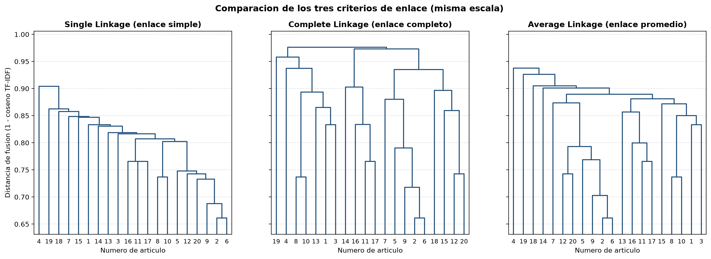

# Análisis del Agrupamiento Jerárquico y Selección del Mejor Criterio (EVA-2)

**Requerimiento 2 · Sprint 4**

## 1. Introducción y objetivo

Este documento compara los agrupamientos jerárquicos aglomerativos obtenidos con los criterios de **Single Linkage**, **Complete Linkage** y **Average Linkage**, y determina cuál produce agrupamientos más coherentes, sustentando la decisión con métricas matemáticas de evaluación interna, como exige el enunciado.

Los tres criterios se aplicaron sobre los $n = 20$ abstracts del corpus, con la distancia $1 - \text{similitud coseno TF-IDF}$ (CLU-1). Una distancia cercana a 0 indica abstracts con mucho vocabulario ponderado en común; cercana a 1, casi ninguno. Como TF-IDF mide coincidencia **léxica** (ver `docs/analisis_comparativo.md`), los grupos reflejan abstracts que comparten términos relevantes, no necesariamente el mismo significado expresado con palabras distintas.

| Insumo | Archivo |
|---|---|
| Matriz de distancias (CLU-1) | `data/matriz_distancias_clustering.json` |
| Historiales de fusión (CLU-2, CLU-3, CLU-4) | `data/clustering/{single,complete,average}_linkage.json` |
| Matrices de enlace (CLU-5) | `data/clustering/matrices_enlace.json` |
| Métricas de evaluación (EVA-1) | `data/clustering/evaluacion.json` |
| Dendrogramas (VIS-1) | `docs/dendrogramas/` |

## 2. Dendrogramas

Los tres árboles se dibujan con la misma escala vertical. El eje empieza cerca de la primera fusión (0,66), porque todas las uniones ocurren entre 0,66 y 0,98.

Dendrogramas individuales: [Single](dendrogramas/single_linkage.png) · [Complete](dendrogramas/complete_linkage.png) · [Average](dendrogramas/average_linkage.png)

## 3. Comportamiento de cada criterio

En la matriz de enlace los artículos aparecen como índices de 0 a 19 (índice = número de artículo − 1). En este documento se usan siempre los **números de artículo**.

### A. Single Linkage (distancia mínima)

Muestra el **efecto cadena** característico de este criterio: como basta con que un solo par de artículos esté cerca para unir dos grupos completos, un grupo va absorbiendo a los demás. Desde la fila 10 hasta la 18, cada fusión agrega **un solo artículo** al grupo principal (en orden: 3, 13, 14, 1, 15, 7, 18, 19 y 4), y la última fusión une el artículo 4 a una distancia de 0,9041. En el dendrograma esto se ve como una escalera continua.

### B. Complete Linkage (distancia máxima)

No presenta efecto cadena: dos grupos solo se unen cuando **todos** sus artículos están relativamente cerca, porque la distancia la decide el par más lejano. Forma bloques compactos de tamaño parecido; al cortar el árbol en 4 grupos se obtienen 9, 6, 4 y 1 artículos. A cambio, las últimas fusiones ocurren a distancias muy altas (0,9733 y 0,9760), porque unir bloques grandes obliga a considerar a sus miembros más alejados: la altura de cada fusión es el diámetro del grupo creado.

### C. Average Linkage (distancia promedio)

En los niveles intermedios forma bloques equilibrados sin efecto cadena: en la fila 13 se consolida un grupo de 9 artículos y en la fila 14 se une con otro de 7 para formar un bloque de 16. Sin embargo, en los niveles superiores los cuatro artículos más alejados del resto (14, 18, 19 y 4) se incorporan de uno en uno (filas 15 a 18). Por eso, al cortar el árbol en 4 grupos produce la misma partición desequilibrada que Single Linkage (17, 1, 1 y 1). La última fusión ocurre a 0,9378, entre los otros dos criterios.

### Resumen estructural

| Criterio de evaluación | Single Linkage | Complete Linkage | Average Linkage |
| :--- | :---: | :---: | :---: |
| Primera fusión | 0,6613 (art. 2 + 6) | 0,6613 (art. 2 + 6) | 0,6613 (art. 2 + 6) |
| Última fusión (raíz) | 0,9041 | 0,9760 | 0,9378 |
| Partición en 4 grupos | 17, 1, 1, 1 | 9, 6, 4, 1 | 17, 1, 1, 1 |
| Efecto cadena | Sí, desde la fila 10 | No | Solo con los 4 artículos atípicos |

## 4. Evaluación con métricas internas (EVA-1)

Las dos métricas se implementaron a mano en `src/clustering/evaluacion.py` y se verificaron contra `scipy` y `sklearn`.

### 4.1 Correlación cofenética (métrica principal)

La distancia cofenética de dos artículos es la altura a la que el dendrograma los une por primera vez. La **correlación cofenética** (CPCC) es la correlación de Pearson entre las distancias originales y las cofenéticas en los 190 pares:

$$\text{CPCC} = \frac{\sum (d - \bar{d})(c - \bar{c})}{\sqrt{\sum (d - \bar{d})^2 \cdot \sum (c - \bar{c})^2}}$$

Mide qué tan fielmente el árbol completo conserva las distancias reales entre artículos, sin necesidad de elegir un número de grupos. Por eso es la métrica adecuada para comparar dendrogramas.

| Criterio | CPCC |
|---|---|
| **Average Linkage** | **0,8097** |
| Single Linkage | 0,7757 |
| Complete Linkage | 0,6536 |

### 4.2 Índice de silueta (métrica complementaria)

La silueta evalúa una **partición** concreta (un corte del árbol en *k* grupos). Para cada artículo compara su distancia promedio a su propio grupo, *a(i)*, con la del grupo vecino más cercano, *b(i)*: $s(i) = \frac{b(i) - a(i)}{\max(a(i), b(i))}$. Va de −1 a 1, y es mayor cuando los grupos son compactos y están bien separados.

| *k* | Single | Complete | Average |
|---|---|---|---|
| 2 | 0,0601 | 0,0313 | 0,0601 |
| 3 | 0,0455 | 0,0446 | 0,0455 |
| 4 | 0,0278 | 0,0463 | 0,0278 |
| 5 | 0,0248 | 0,0455 | 0,0173 |
| 6 | 0,0124 | 0,0384 | 0,0396 |
| 7 | 0,0037 | 0,0388 | 0,0497 |
| 8 | 0,0072 | 0,0390 | 0,0492 |

Los valores son muy bajos para los tres criterios (todos menores de 0,07). Además, el máximo de Single y Average (0,0601 con *k* = 2) corresponde a una partición de 19 artículos frente a 1, que no es útil. **La silueta indica que el corpus no tiene grupos bien separados**: los 20 artículos tratan un mismo dominio (inteligencia artificial en educación), y sus distancias se concentran entre 0,66 y 0,98. En ese contexto, ningún corte del árbol produce grupos claramente diferenciados, y la comparación entre criterios debe apoyarse en la jerarquía completa, que es lo que mide la CPCC.

## 5. Agrupaciones robustas

Algunos grupos aparecen **idénticos en los tres árboles**, sin importar el criterio. Que tres criterios distintos coincidan indica que esas agrupaciones reflejan una cercanía real entre los abstracts:

| Grupo | Artículos | Tema común |
|---|---|---|
| {11, 16, 17} | *A scoping review on how generative AI transforms assessment…*, *Generative AI in Tertiary Education: Assessment Redesign…*, *A Systematic Review of AI-Driven Educational Assessment in STEM…* | Evaluación del aprendizaje con IA |
| {2, 6, 9} | *Systematic literature review on opportunities, challenges…*, *A multi-perspective study on AI in Education…*, *AI technologies for education: Recent research & future directions* | Panoramas generales de la investigación en IA educativa |
| {8, 10} | *A systematic review of AI techniques for collaborative learning…*, *Educational applications of AI in simulation-based learning…* | IA aplicada a modalidades de aprendizaje |

En el otro extremo, los artículos **4** (resolución de problemas complejos) y **19** (impacto de ChatGPT) se unen a los demás en las últimas fusiones de los tres árboles, y el **18** (revisión sobre IA generativa) también en Single y Average. Son los abstracts con vocabulario más particular dentro del corpus.

## 6. Conclusión: el criterio más coherente

**Average Linkage produce el agrupamiento jerárquico más coherente**, sustentado en la métrica principal: tiene la mayor correlación cofenética (0,8097), es decir, es el árbol que mejor conserva las distancias reales entre los abstracts.

1. **Equilibrio entre los otros dos criterios.** Al promediar todas las distancias entre los miembros de dos grupos, no se deja arrastrar por un único par muy cercano, que es lo que produce el efecto cadena de Single Linkage, ni por un único par muy lejano, que es lo que lleva a Complete Linkage a unir sus bloques finales a alturas cercanas a 0,98 y a la CPCC más baja (0,6536).
2. **Estructura intermedia coherente.** Forma bloques equilibrados en los niveles intermedios y conserva las tres agrupaciones robustas de la sección 5.
3. **Matiz:** si el objetivo fuera obtener una partición plana en pocos grupos de tamaño parecido, Complete Linkage es mejor opción: su partición en 4 grupos es la más equilibrada (9, 6, 4 y 1) y tiene la mejor silueta para *k* = 4. Pero con siluetas tan bajas en todos los criterios, esa partición no corresponde a grupos claramente separados.

En síntesis, los datos muestran un corpus temáticamente homogéneo, con unos pocos núcleos estables (evaluación con IA, panoramas generales de IA educativa e IA para modalidades de aprendizaje) y algunos artículos atípicos. Average Linkage es el criterio que mejor representa esa estructura en el árbol completo.
