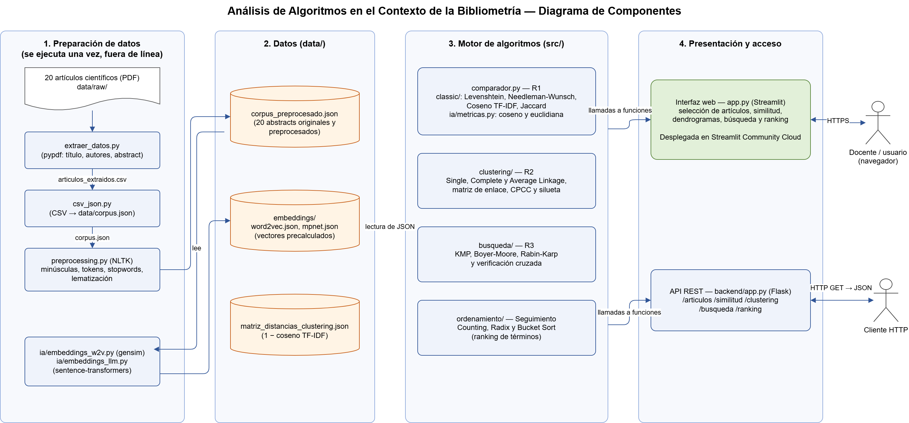
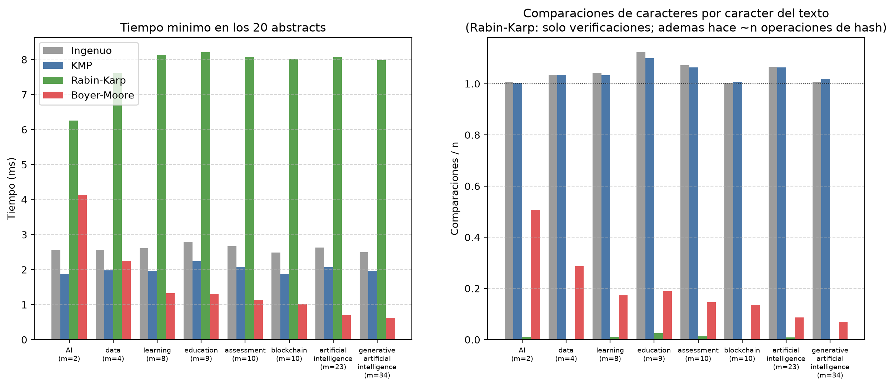
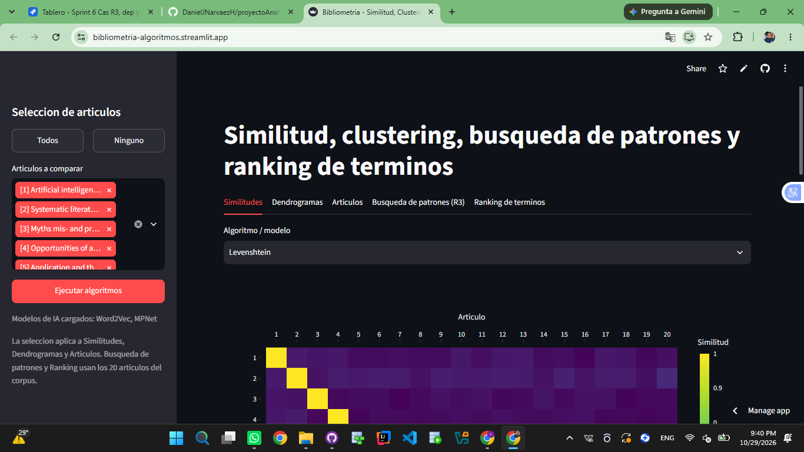

# Documento Técnico del Proyecto

**Análisis de Algoritmos en el Contexto de la Bibliometría**
Universidad del Quindío · Programa de Ingeniería de Sistemas y Computación · Semestre 2026-2

**Equipo:** Daniel Josué Narváez Hincapié · Camilo Alberto Ospina


---

## 1. Introducción

El estudio computacional de textos permite explorar y analizar grandes volúmenes de producción científica mediante métodos cuantitativos y cualitativos, apoyados en fundamentos matemáticos y estadísticos. En este proyecto, dicho estudio se aplica sobre un dominio de conocimiento específico: la **inteligencia artificial generativa**.

El reto central es doble: por un lado, procesar lenguaje natural no estructurado (los abstracts de artículos científicos); por otro, recorrer la transición conceptual desde las estructuras de datos y algoritmos clásicos de similitud textual, hasta los modelos modernos basados en Inteligencia Artificial (embeddings). El proyecto exige que esta transición no se quede en el uso de librerías de alto nivel, sino que cada algoritmo sea implementado explícitamente por el equipo, de forma que su comportamiento interno sea completamente transparente y analizable.

El desarrollo se organiza en torno a cuatro requerimientos:

- **Requerimiento 1 — Análisis de Similitud Textual:** selección dinámica de dos o más artículos del corpus, y comparación de sus abstracts mediante 4 algoritmos clásicos (basados en distancia de edición y en modelos de espacio vectorial) y 2 enfoques de Inteligencia Artificial (embeddings), incluyendo la demostración matemática paso a paso sobre un caso de estudio concreto y el análisis crítico comparativo entre ambos enfoques.
- **Requerimiento 2 — Agrupamiento Jerárquico (Clustering):** implementación desde cero de 3 criterios de agrupamiento jerárquico (Single, Complete y Average Linkage) sobre los 20 abstracts, construcción del dendrograma correspondiente a cada uno, y determinación de cuál produce agrupamientos más coherentes mediante una métrica de evaluación interna.
- **Requerimiento 3 — Búsqueda de Patrones:** localización de las ocurrencias exactas de un patrón en los 20 abstracts con 3 algoritmos de coincidencia de cadenas implementados desde cero (Knuth-Morris-Pratt, Boyer-Moore y Rabin-Karp), con caso de estudio paso a paso y análisis crítico basado en la complejidad asintótica contrastada con tiempos medidos.
- **Requerimiento 4 — Despliegue y Documentación Técnica:** el proyecto debe quedar desplegado y accesible, soportado por la documentación técnica correspondiente a cada requerimiento.

Además, como entrega de seguimiento, se generó el **ranking de los términos más frecuentes** del corpus con tres algoritmos de ordenamiento sin comparaciones (Counting Sort, Radix Sort y Bucket Sort).

Este documento técnico consolida, para cada uno de estos requerimientos, la arquitectura, la implementación, el análisis matemático y crítico exigido, y la declaración explícita del uso de herramientas de IA generativa como apoyo al desarrollo (nunca como reemplazo del diseño algorítmico ni del análisis formal solicitado en el curso).

## 2. Fuentes de Información

A diferencia de un proceso tradicional de recolección automatizada sobre bases de datos científicas (como ACM, SAGE o ScienceDirect), este proyecto trabaja sobre un **corpus documental controlado y estático**, suministrado directamente por el docente.

**Características del corpus:**

- **Tamaño:** 20 artículos científicos.
- **Formato de origen:** PDF.
- **Dominio de conocimiento:** inteligencia artificial generativa.
- **Alcance del procesamiento:** el análisis computacional y la implementación de los algoritmos se enfocan de manera estricta y primordial sobre el **abstract (resumen)** de cada artículo. Es el campo de texto sobre el que corren todos los algoritmos de similitud y de clustering.
- **Metadatos adicionales:** título del artículo y autores. Estos no se someten a los algoritmos de similitud/clustering, pero se extraen y se usan como identificadores y para requerimientos funcionales puntuales que exijan cruce de información (por ejemplo, mostrar en la interfaz qué artículo corresponde a cada resultado).

**Proceso de obtención (Sprint 1, épica EPIC-1):**

1. **Extracción (EXT-1, `src/extraer_datos.py`).** Se usa `pypdf` para extraer el texto completo de cada PDF. El título se toma de las primeras líneas del documento, los autores de las líneas entre el título y el encabezado *Abstract*, y el abstract mediante expresiones regulares que capturan el texto entre *Abstract* y *Keywords*/*Introduction*. El resultado crudo queda en `data/raw/articulos_extraidos.csv`.
2. **Estructuración (EXT-2, `src/csv_json.py`).** El CSV se normaliza a `data/corpus.json`, con 20 registros de estructura `{numero, titulo, autores, abstract}`. El campo `numero` (1–20) funciona como identificador único del artículo y es el que usan todos los módulos posteriores para seleccionarlo.
3. **Preprocesamiento (PRE-1, `src/preprocessing.py`).** La función reutilizable `preprocess_text()` aplica, en orden: reconstrucción de ligaduras tipográficas mal extraídas (`arti ficial` → `artificial`, validando contra el diccionario de inglés de NLTK), normalización Unicode NFKC, reconstrucción de palabras partidas por guion de fin de línea (`edu- cational` → `educational`), resolución de palabras compuestas con guion o barra (`problem-solving` → `problem solving`; con prefijos como `inter-` o `non-` se une: `inter-disciplinary` → `interdisciplinary`), minúsculas, tokenización, eliminación de puntuación, números y *stopwords* en inglés (más residuos académicos como `et`, `al`, `fig`), y lematización con desambiguación por categoría gramatical (WordNet + etiquetador POS). El corpus resultante se guarda en `data/corpus_preprocesado.json`, que agrega a cada artículo `abstract_preprocesado` (lista de tokens) y `abstract_preprocesado_texto` (los mismos tokens unidos por espacios).
4. **Validación manual (PRE-2, `docs/validacion_corpus.md`).** Se revisaron los abstracts extraídos contra los PDF originales. El hallazgo principal fue que las palabras compuestas con guion o barra (`English-written`, `meta-analyses`, `Human-AI`, `design/methodology/approach`, entre otras, en 17 de los 20 artículos) quedaban fusionadas en un único token inexistente (`englishwritten`, `metaanalyses`, `humanai`). La corrección se incorporó como regla genérica en el propio preprocesamiento, de modo que el corpus preprocesado se regenera de forma reproducible ejecutando `python src/preprocessing.py`, sin ediciones manuales sobre el JSON. El único caso que no admite regla genérica (artículo 5, `de fi- nitions`, donde coinciden una ligadura y un guion de fin de línea) se corrige mediante una tabla explícita de correcciones puntuales (`CORRECCIONES_PUNTUALES`).

**Características del corpus procesado:**

| Medida | Valor |
|---|---|
| Artículos | 20 |
| Longitud del abstract crudo | 134 a 263 palabras (promedio ≈ 202) |
| Longitud del abstract preprocesado | 77 a 159 tokens (≈ 2.530 en total) |
| Vocabulario (tokens distintos, todo el corpus) | 868 términos, de los cuales 484 (≈ 56 %) aparecen una sola vez |
| Términos más frecuentes | `ai`, `education`, `review`, `research`, `aied`, `assessment` |

## 3. Arquitectura del Sistema

### 3.1 Visión general

El sistema se organiza en cuatro bloques, que van desde los PDF del corpus hasta la aplicación desplegada:

1. **Preparación de datos (fuera de línea).** Extrae título, autores y abstract de los 20 PDF, los estructura en JSON y preprocesa los abstracts. También genera, una sola vez, los embeddings de los dos modelos de IA. Se ejecuta antes de usar la aplicación, no cada vez que se consulta.
2. **Datos (`data/`).** Archivos JSON con el corpus preprocesado, los embeddings precalculados y la matriz de distancias del clustering. Son la entrada de todos los algoritmos.
3. **Motor de algoritmos (`src/`).** Implementaciones propias de los algoritmos de los cuatro bloques del proyecto: similitud textual (R1), agrupamiento jerárquico (R2), búsqueda de patrones (R3) y ranking de términos (seguimiento).
4. **Presentación y acceso.** La interfaz web en Streamlit, desplegada en Streamlit Community Cloud, que es la que usa el docente desde el navegador, y una API REST en Flask que expone los mismos algoritmos en formato JSON.

Las dos formas de acceso llaman directamente a las funciones de `src/`, de modo que cada algoritmo existe una sola vez en el código.

**Figura 1.** Diagrama de componentes del sistema.



*Fuente editable: `docs/diagramas/arquitectura.drawio` (draw.io).*

### 3.2 Módulos del sistema

| Módulo | Carpeta o archivo | Responsable | Descripción |
|---|---|---|---|
| Extracción | `src/extraer_datos.py`, `src/csv_json.py` | Camilo Ospina | Extrae título, autores y abstract de los 20 PDF y los estructura en `data/corpus.json`. |
| Preprocesamiento | `src/preprocessing.py` | Daniel Narváez | Limpieza y normalización de los abstracts (minúsculas, tokenización, *stopwords*, lematización). |
| Algoritmos clásicos (R1) | `src/classic/` | Daniel Narváez (Levenshtein, Needleman-Wunsch) · Camilo Ospina (TF-IDF + coseno, Jaccard) | Los 4 algoritmos clásicos de similitud textual. |
| Modelos de IA (R1) | `src/ia/` | Daniel Narváez (Word2Vec) · Camilo Ospina (MPNet) | Generación de embeddings y métricas coseno y euclidiana. |
| Comparador (R1) | `src/comparador.py` | Equipo | Integra los 6 algoritmos para dos o más artículos seleccionados. |
| Clustering (R2) | `src/clustering/` | Camilo Ospina (matriz de distancias, Average Linkage, dibujo de dendrogramas) · Daniel Narváez (Single y Complete Linkage, dendrograma, evaluación) | Los 3 criterios de agrupamiento jerárquico, dendrogramas y métricas de evaluación. |
| Búsqueda de patrones (R3) | `src/busqueda/` | Daniel Narváez (KMP, Rabin-Karp) · Camilo Ospina (Boyer-Moore, verificación) | Los 3 algoritmos de coincidencia exacta de cadenas. |
| Ordenamiento (seguimiento) | `src/ordenamiento/` | Daniel Narváez (Counting, Bucket) · Camilo Ospina (frecuencias, Radix) | Ranking de términos con algoritmos de ordenamiento sin comparaciones. |
| Interfaz web | `app.py` | Camilo Ospina | Aplicación Streamlit con una pestaña por requerimiento. |
| API REST | `backend/app.py` | Daniel Narváez | Endpoints de similitud, clustering, búsqueda y ranking. |
| Despliegue | Streamlit Community Cloud | Daniel Narváez | Publicación de la interfaz en una URL accesible. |

### 3.3 Herramientas utilizadas

| Herramienta | Uso en el proyecto |
|---|---|
| Python 3.11 | Lenguaje de todo el proyecto. Los algoritmos se implementan con listas, diccionarios y ciclos, sin funciones de alto nivel que los resuelvan. |
| pypdf | Lectura del texto de los PDF (extracción). |
| NLTK | Tokenización, *stopwords*, etiquetado gramatical y lematización con WordNet (preprocesamiento). |
| gensim | Carga del modelo preentrenado `word2vec-google-news-300` para obtener los vectores de las palabras. |
| sentence-transformers | Carga del modelo preentrenado `all-mpnet-base-v2` para obtener el vector de cada abstract. |
| matplotlib y SciPy | Solo para **dibujar**: los dendrogramas (`scipy.cluster.hierarchy.dendrogram`) y las gráficas de tiempos. Ningún cálculo de similitud, clustering, búsqueda u ordenamiento usa estas librerías. |
| pandas y Plotly | Tablas y gráficas interactivas de la interfaz. |
| Streamlit | Interfaz web de la aplicación. |
| Streamlit Community Cloud | Servicio gratuito donde se despliega la interfaz, con HTTPS. |
| Flask | API REST del backend. |
| unittest | Pruebas unitarias (348 pruebas en total). |
| Git, GitHub y GitHub Desktop | Control de versiones y repositorio público. |
| Jira | Planeación por sprints, épicas y tareas. |
| draw.io | Diagrama de componentes. |
| Visual Studio Code | Entorno de desarrollo. |

**Decisiones de diseño.**

- **Interfaz en Streamlit.** Permite construir la interfaz en el mismo lenguaje que los algoritmos e importar directamente sus funciones, sin una capa intermedia.
- **API en Flask.** En la planeación inicial se había previsto FastAPI. Se eligió Flask porque la interfaz no consume la API (llama a los módulos de `src/` directamente), así que la API solo debía exponer los algoritmos de forma simple: con Flask cada endpoint es una función de pocas líneas que se prueba abriendo la URL en el navegador.
- **Despliegue en Streamlit Community Cloud.** El enunciado pide un servicio accesible "tipo Render, Railway o similar". Streamlit Community Cloud despliega la interfaz directamente desde el repositorio de GitHub, sin configurar servidores, y publica una URL con HTTPS.
- **Embeddings precalculados.** Los modelos de IA ocupan varios GB y tardan en cargar. Como los 20 abstracts no cambian, sus vectores se calcularon una sola vez y se guardaron en `data/embeddings/`. La aplicación solo lee esos archivos y calcula las similitudes con las funciones propias.

### 3.4 Estructura del repositorio

Repositorio público: <https://github.com/DanielJNarvaezH/proyectoAnalisisAlgoritmos>. La raíz contiene el `README.md` (con el enlace a la aplicación), la licencia y la carpeta del proyecto, `analisis-algoritmos-bibliometria/`, organizada así:

```
analisis-algoritmos-bibliometria/
├── app.py                      Interfaz web (Streamlit), punto de entrada del despliegue
├── requirements.txt            Dependencias de la interfaz (las usa Streamlit Cloud)
├── requirements-backend.txt    Dependencia de la API (Flask)
├── backend/
│   └── app.py                  API REST (Flask)
├── src/                        Código fuente de todos los algoritmos
│   ├── extraer_datos.py        Extracción de título, autores y abstract de los PDF
│   ├── csv_json.py             Conversión del CSV extraído a data/corpus.json
│   ├── preprocessing.py        Preprocesamiento de los abstracts
│   ├── comparador.py           Integra los 6 algoritmos del R1 para los artículos elegidos
│   ├── classic/                R1 — algoritmos clásicos
│   │   ├── levenshtein.py
│   │   ├── needleman_wunsch.py
│   │   ├── tfidf_cosine.py
│   │   ├── jaccard.py
│   │   └── classics.py         Comparador de consola de los 4 clásicos
│   ├── ia/                     R1 — modelos de IA
│   │   ├── embeddings_w2v.py   Vector de cada abstract con Word2Vec (promedio)
│   │   ├── embeddings_llm.py   Vector de cada abstract con all-mpnet-base-v2
│   │   └── metricas.py         Coseno, distancia y similitud euclidiana
│   ├── clustering/             R2 — agrupamiento jerárquico
│   │   ├── distance_matrix.py  Matriz de distancias 1 − coseno TF-IDF
│   │   ├── aglomerativo.py     Procedimiento aglomerativo común
│   │   ├── single_linkage.py
│   │   ├── complete_linkage.py
│   │   ├── average_linkage.py
│   │   ├── dendrograma.py      Matriz de enlace y su validación
│   │   ├── evaluacion.py       Correlación cofenética e índice de silueta
│   │   └── visualizacion.py    Dibujo de los dendrogramas
│   ├── busqueda/               R3 — búsqueda de patrones
│   │   ├── kmp.py
│   │   ├── rabin_karp.py
│   │   ├── boyer_moore.py
│   │   ├── verificacion_busqueda.py   Busca en los 20 abstracts y compara los 3 algoritmos
│   │   └── comparacion_busqueda.py    Medición de tiempos del análisis crítico
│   └── ordenamiento/           Seguimiento — ranking de términos
│       ├── frecuencias.py      Lista (término, frecuencia) del corpus
│       ├── counting_sort.py
│       ├── radix_sort.py
│       ├── bucket_sort.py
│       └── comparacion.py      Medición de tiempos del seguimiento
├── data/
│   ├── raw/articulos_extraidos.csv     Resultado crudo de la extracción
│   ├── corpus.json                     20 artículos: número, título, autores, abstract
│   ├── corpus_preprocesado.json        Corpus con los abstracts preprocesados
│   ├── embeddings/                     word2vec.json y mpnet.json (vectores precalculados)
│   ├── matriz_distancias_clustering.json
│   ├── clustering/                     Historial de fusiones, matrices de enlace y evaluación
│   └── resultados/                     Resultados de las mediciones (JSON)
├── docs/                       Documentación
│   ├── documento_tecnico.md    Este documento
│   ├── diagramas/              Diagrama de componentes (.drawio y .png)
│   ├── caso_estudio_clasicos.md, modelos_ia.md, analisis_comparativo.md     R1
│   ├── analisis_clustering.md, dendrogramas/                                 R2
│   ├── caso_estudio_busqueda.md, analisis_busqueda.md, busqueda/             R3
│   ├── seguimiento_ordenamiento.md, seguimiento/                             Seguimiento
│   └── validacion_corpus.md    Validación manual del corpus extraído
├── notebooks/                  Scripts que reproducen los casos de estudio
│   ├── caso_estudio_cas2.py    Levenshtein y Needleman-Wunsch (sección 4)
│   ├── caso_estudio_cas3.py    TF-IDF + coseno y Jaccard (sección 4)
│   ├── analisis_comparativo.py Clásicos frente a IA (sección 5.7)
│   ├── diagnostico_terminos_w2v.py   Revisión de las siglas en Word2Vec (sección 5.2)
│   └── caso_estudio_cas5.py    KMP, Rabin-Karp y Boyer-Moore (sección 7)
└── tests/                      Pruebas unitarias, una carpeta por módulo de src/
```

Los PDF originales los entregó el docente y no se incluyen en el repositorio; para repetir la extracción se ubican en `data/pdfs/`. Las carpetas `venv/` (entorno virtual) y los archivos temporales están excluidos en `.gitignore`.


## 4. Algoritmos Clásicos de Similitud Textual (Requerimiento 1, parte 1)

### 4.1 Visión general

El Requerimiento 1 exige la implementación desde cero de 4 algoritmos clásicos de similitud textual, organizados en dos familias según el fundamento matemático que utilizan:

- **Basados en distancia de edición** (comparan las secuencias de tokens posición por posición): Levenshtein y Needleman-Wunsch.
- **Basados en vectorización y conjuntos** (ignoran el orden de las palabras): Similitud del Coseno con TF-IDF y Coeficiente de Jaccard.

Los cuatro se implementaron en `src/classic/` sin usar ninguna librería que resuelva el algoritmo directamente (ni `python-Levenshtein`/`rapidfuzz`, ni `Bio.pairwise2`, ni `TfidfVectorizer` de scikit-learn), únicamente con estructuras de datos básicas de Python. Los cuatro reciben como entrada `abstract_preprocesado` (la lista de tokens ya limpia, sin stopwords y lematizada, construida en PRE-1 y validada en PRE-2), garantizando que las cuatro métricas se calculen sobre exactamente el mismo texto base y sean comparables entre sí.

Los cuatro módulos cuentan con pruebas unitarias: Levenshtein (24 tests), Needleman-Wunsch (19 tests), TF-IDF + Coseno (18 tests) y Jaccard (16 tests). El comparador interactivo `classics.py` (CLA-5) integra los cuatro directamente por import, sin duplicar lógica.

### 4.2 Distancia de Levenshtein

**Fundamento teórico:** mide el número mínimo de operaciones de edición (inserción, eliminación, sustitución) necesarias para transformar una secuencia de tokens A en otra secuencia B. Se implementa mediante programación dinámica, construyendo una matriz D de tamaño `(n+1)×(m+1)` (siendo n y m el número de tokens de cada abstract) con la recurrencia:

```
D[i][0] = i,  D[0][j] = j
D[i][j] = D[i-1][j-1]                                  si A[i-1] == B[j-1]
D[i][j] = 1 + min(D[i-1][j], D[i][j-1], D[i-1][j-1])   en otro caso
```

El camino óptimo (qué operación se aplicó en cada paso) se reconstruye mediante *backtracking* sobre la matriz ya construida (función `traceback()`), retrocediendo desde `D[n][m]` hasta `D[0][0]`.

**Complejidad algorítmica:**
- **Tiempo:** O(n·m) — se llena cada una de las `(n+1)×(m+1)` celdas de la matriz una sola vez, con trabajo constante por celda.
- **Espacio:** O(n·m) — se conserva la matriz completa (no solo la fila anterior) de forma deliberada, para poder mostrar el llenado paso a paso exigido en el caso de estudio; una implementación optimizada solo para obtener la distancia final podría reducirse a O(min(n,m)).

**Implementación:** `src/classic/levenshtein.py` — `build_levenshtein_matrix()`, `traceback()`, `levenshtein_distance()`, `levenshtein_similarity()`, `similarity_matrix()`.

**Ejemplo paso a paso.** La matriz completa de los artículos 2 y 9 tendría 78 × 112 celdas, así que la demostración usa un fragmento real y contiguo de 6 tokens de cada abstract (caso de estudio completo en `docs/caso_estudio_clasicos.md`):

- A (artículo 2): `application artificial intelligence education aied emerge`
- B (artículo 9): `study artificial intelligence education aied publish`

La primera fila y la primera columna valen 0, 1, 2, …, 6 (convertir una secuencia vacía cuesta tantas inserciones como tokens). Cada celda se llena con la recurrencia, de izquierda a derecha y de arriba abajo. Por ejemplo, `D[1][1]` compara `application` con `study`: son distintos, así que vale 1 + mín(D[0][1], D[1][0], D[0][0]) = 1 + mín(1, 1, 0) = 1. Y `D[2][2]` compara `artificial` con `artificial`: son iguales, así que copia la diagonal, D[1][1] = 1.

| | ε | study | artificial | intelligence | education | aied | publish |
|---|---|---|---|---|---|---|---|
| **ε** | 0 | 1 | 2 | 3 | 4 | 5 | 6 |
| **application** | 1 | **1** | 2 | 3 | 4 | 5 | 6 |
| **artificial** | 2 | 2 | **1** | 2 | 3 | 4 | 5 |
| **intelligence** | 3 | 3 | 2 | **1** | 2 | 3 | 4 |
| **education** | 4 | 4 | 3 | 2 | **1** | 2 | 3 |
| **aied** | 5 | 5 | 4 | 3 | 2 | **1** | 2 |
| **emerge** | 6 | 6 | 5 | 4 | 3 | 2 | **2** |

El *backtracking* desde `D[6][6]` recorre la diagonal en negrita: una sustitución (`application` → `study`), cuatro coincidencias y otra sustitución (`emerge` → `publish`). Distancia = **2**; similitud = 1 − 2 / máx(6, 6) = **0,6667**.

### 4.3 Needleman-Wunsch

**Fundamento teórico:** realiza un alineamiento global entre dos secuencias, similar en mecánica a Levenshtein pero con un esquema de puntuación en vez de costos: coincidencia = +1, sustitución = −1, gap (inserción/eliminación) = −2. Se busca el alineamiento que **maximiza** el puntaje total, en vez de minimizar el costo:

```
S[i][0] = i·gap,  S[0][j] = j·gap
S[i][j] = max( S[i-1][j-1] + (match si A[i-1]==B[j-1], si no mismatch),
               S[i-1][j] + gap,
               S[i][j-1] + gap )
```

A diferencia de Levenshtein, el resultado no es un solo número sino un **alineamiento explícito** de ambas secuencias (con huecos `-` donde fue necesario), reconstruido también por `traceback()`.

**Complejidad algorítmica:**
- **Tiempo:** O(n·m), igual que Levenshtein — misma estructura de matriz y misma cantidad de trabajo por celda.
- **Espacio:** O(n·m), por la misma razón (se conserva la matriz completa para el caso de estudio).

**Implementación:** `src/classic/needleman_wunsch.py` — `build_score_matrix()`, `traceback()`, `needleman_wunsch_alignment()`, `needleman_wunsch_similarity()`, `similarity_matrix()`.

**Ejemplo paso a paso** (mismos fragmentos que en Levenshtein). La primera fila y la primera columna valen 0, −2, −4, …, −12 (un *gap* por token). Por ejemplo, `S[1][1]` compara `application` con `study`: máx(S[0][0] − 1, S[0][1] − 2, S[1][0] − 2) = máx(−1, −4, −4) = −1. Y `S[2][2]` compara `artificial` con `artificial`: máx(S[1][1] + 1, S[1][2] − 2, S[2][1] − 2) = máx(0, −5, −5) = 0.

| | ε | study | artificial | intelligence | education | aied | publish |
|---|---|---|---|---|---|---|---|
| **ε** | 0 | −2 | −4 | −6 | −8 | −10 | −12 |
| **application** | −2 | **−1** | −3 | −5 | −7 | −9 | −11 |
| **artificial** | −4 | −3 | **0** | −2 | −4 | −6 | −8 |
| **intelligence** | −6 | −5 | −2 | **1** | −1 | −3 | −5 |
| **education** | −8 | −7 | −4 | −1 | **2** | 0 | −2 |
| **aied** | −10 | −9 | −6 | −3 | 0 | **3** | 1 |
| **emerge** | −12 | −11 | −8 | −5 | −2 | 1 | **2** |

Alineamiento óptimo (*backtracking* por la diagonal):

```
A:  application  artificial  intelligence  education  aied  emerge
B:  study        artificial  intelligence  education  aied  publish
     −1            +1           +1            +1        +1     −1      = 2
```

Puntaje = **2** (coincide con `S[6][6]`); similitud = coincidencias / longitud del alineamiento = 4 / 6 = **0,6667**. En este fragmento ambos algoritmos dan el mismo valor porque el alineamiento óptimo no usa *gaps*; la sección 5.7 muestra que esto ocurre en casi todo el corpus.

### 4.4 TF-IDF + Similitud del Coseno

**Fundamento teórico:** en vez de comparar las secuencias posición por posición, representa cada abstract como un vector numérico en un espacio de dimensión igual al vocabulario del corpus. Cada componente del vector combina dos factores:
- **TF** (frecuencia de término): `TF(t,d) = conteo(t,d) / total_términos(d)`.
- **IDF** (frecuencia inversa de documento, variante suavizada): `IDF(t) = log(N / (1+df(t))) + 1`, donde N es el número de documentos comparados y df(t) el número de esos documentos en los que aparece t.

La similitud entre dos documentos se calcula como el coseno del ángulo entre sus vectores TF-IDF:

```
similitud(A,B) = (A · B) / (‖A‖ · ‖B‖)
```

Este enfoque ignora completamente el orden de las palabras: solo le importa qué tan parecida es la distribución de vocabulario relevante entre los dos documentos.

**Complejidad algorítmica** (N = documentos comparados, V = tamaño del vocabulario conjunto, L = longitud promedio de un abstract):
- **Tiempo:** construir el vocabulario y el IDF cuesta O(N·L); vectorizar los N documentos cuesta O(N·V) (se recorre el vocabulario completo por cada documento); calcular la similitud coseno de un par cuesta O(V). Para la matriz de similitud completa entre N documentos: O(N²·V).
- **Espacio:** O(N·V) para almacenar la matriz TF-IDF (un vector denso de tamaño V por documento).

**Implementación:** `src/classic/tfidf_cosine.py` — `calcular_tf()`, `calcular_idf()`, `construir_vocabulario()`, `vectorizar_tfidf()`, `similitud_coseno()`, `matriz_similitud()`.

**Ejemplo paso a paso** con los mismos dos fragmentos de 6 tokens, tratados como dos documentos (N = 2):

1. **Vocabulario:** 8 términos distintos. Cuatro aparecen en ambos fragmentos (`artificial`, `intelligence`, `education`, `aied`) y cuatro en uno solo (`application`, `emerge`, `study`, `publish`).
2. **TF:** cada token aparece una vez en un fragmento de 6, así que TF = 1/6 = 0,1667.
3. **IDF:** para los términos compartidos, IDF = log(2 / (1 + 2)) + 1 = 0,5945; para los exclusivos, IDF = log(2 / (1 + 1)) + 1 = 1.
4. **Pesos TF × IDF:** compartidos 0,1667 × 0,5945 = **0,0991**; exclusivos 0,1667 × 1 = **0,1667**.

| Término | aied | application | artificial | education | emerge | intelligence | publish | study |
|---|---|---|---|---|---|---|---|---|
| Vector A | 0,0991 | 0,1667 | 0,0991 | 0,0991 | 0,1667 | 0,0991 | 0 | 0 |
| Vector B | 0,0991 | 0 | 0,0991 | 0,0991 | 0 | 0,0991 | 0,1667 | 0,1667 |

5. **Coseno:** solo los 4 términos compartidos aportan al producto punto.

$$A \cdot B = 4 \times 0{,}0991^2 = 0{,}0393 \qquad \|A\| = \|B\| = \sqrt{4 \times 0{,}0991^2 + 2 \times 0{,}1667^2} = 0{,}3079$$

$$\cos(A, B) = \frac{0{,}0393}{0{,}3079 \times 0{,}3079} = \mathbf{0{,}4142} \qquad \theta = \arccos(0{,}4142) \approx 65{,}5^\circ$$

Los términos compartidos pesan menos (IDF 0,5945) porque, en un corpus de dos documentos, un término que está en ambos no ayuda a distinguirlos.

### 4.5 Coeficiente de Jaccard

**Fundamento teórico:** el más simple de los cuatro. Representa cada abstract como un **conjunto** de tokens (o n-gramas) únicos, e ignora tanto el orden como la frecuencia de aparición — solo importa si un término está presente o no:

```
J(A,B) = |A ∩ B| / |A ∪ B|
```

Se implementó de forma parametrizable en el tamaño de n-grama (`n=1` por defecto, unigramas/palabras sueltas), permitiendo también comparar por bigramas o trigramas si se requiere mayor sensibilidad al contexto local.

**Complejidad algorítmica** (N = documentos comparados, L = longitud promedio de un abstract):
- **Tiempo:** construir el conjunto de n-gramas de un documento cuesta O(L); calcular la intersección/unión de dos conjuntos con tablas hash cuesta, en promedio, O(|A|+|B|). Para la matriz de similitud completa entre N documentos: O(N²·L).
- **Espacio:** O(N·L) para almacenar los N conjuntos de tokens.

**Implementación:** `src/classic/jaccard.py` — `tokenizar()`, `generar_ngramas()`, `texto_a_conjunto()`, `jaccard()`, `matriz_jaccard()`.

**Ejemplo paso a paso** con los mismos fragmentos: A = {application, artificial, intelligence, education, aied, emerge} y B = {study, artificial, intelligence, education, aied, publish}.

$$|A \cap B| = |\{artificial, intelligence, education, aied\}| = 4 \qquad |A \cup B| = 8 \qquad J(A, B) = \frac{4}{8} = \mathbf{0{,}5}$$

### 4.6 Resumen comparativo de complejidad

| Algoritmo | Tiempo | Espacio | ¿Sensible al orden? |
|---|---|---|---|
| Levenshtein | O(n·m) | O(n·m) | Sí |
| Needleman-Wunsch | O(n·m) | O(n·m) | Sí |
| TF-IDF + Coseno | O(N²·V) para la matriz completa | O(N·V) | No |
| Jaccard | O(N²·L) para la matriz completa | O(N·L) | No |

*(n, m: longitud en tokens de cada abstract comparado · N: número de documentos · V: tamaño del vocabulario conjunto · L: longitud promedio de un abstract)*

Levenshtein y Needleman-Wunsch escalan con el **producto de las longitudes** de los dos textos comparados, por lo que resultan más costosos cuanto más largos son los abstracts, independientemente de cuántos documentos tenga el corpus. TF-IDF y Jaccard, en cambio, escalan con el **cuadrado del número de documentos**, por lo que resultan más costosos cuando se quiere comparar un corpus grande completo (los 20 artículos entre sí) que cuando se comparan solo 2 o 3 artículos puntuales, como en el caso de estudio.

### 4.7 Resultados sobre el caso de estudio (artículos 2 y 9)

Los cuatro algoritmos se ejecutaron sobre el mismo par de artículos, seleccionado en CAS-1 y documentado en detalle en [`/docs/caso_estudio_clasicos.md`](./caso_estudio_clasicos.md):

| Algoritmo | Similitud (artículos 2 vs 9) |
|---|---|
| Levenshtein | 0.0901 |
| Needleman-Wunsch | 0.0901 |
| Jaccard | 0.1583 |
| TF-IDF + Coseno | 0.2553 |

**Análisis crítico:** ninguno de los cuatro algoritmos reporta una similitud alta entre estos dos artículos (todos por debajo de 0.30), pero se observa un patrón consistente: los algoritmos sensibles al orden posicional (Levenshtein y Needleman-Wunsch, ambos ≈0.09) dan una similitud notablemente más baja que los que ignoran el orden (Jaccard 0.16, TF-IDF+Coseno 0.26). Esto ocurre pese a que ambos abstracts comparten vocabulario temático directamente relevante (`artificial`, `intelligence`, `education`, `aied`), lo cual confirma que la elección del algoritmo no es neutral: Levenshtein/Needleman-Wunsch son apropiados cuando importa la estructura/secuencia exacta del texto, mientras que Jaccard y TF-IDF+Coseno son más apropiados para capturar cercanía temática independientemente de cómo esté redactada cada oración. Esta misma tensión (orden vs. contenido) es el punto de partida para el análisis comparativo frente a los modelos de IA (sección 5.7).

## 5. Modelos de Inteligencia Artificial y Embeddings (Requerimiento 1, parte 2)

Esta sección documenta los dos enfoques de similitud basados en IA exigidos por el Requerimiento 1, las métricas con las que se comparan sus vectores y el análisis comparativo frente a los algoritmos clásicos. El detalle completo está en `docs/modelos_ia.md` (selección, implementación y resultados de los modelos) y en `docs/analisis_comparativo.md` (análisis crítico).

### 5.1 Fundamentos: de la representación léxica a la representación densa

Los modelos de espacio vectorial clásicos, como TF-IDF, asignan una dimensión independiente a cada término del vocabulario. En esa representación, `AI` y `artificial intelligence`, o `students` y `learners`, ocupan dimensiones distintas y ortogonales, así que el modelo no tiene ninguna noción de que significan lo mismo: dos textos que expresan la misma idea con palabras diferentes obtienen similitud 0.

Los **embeddings** resuelven esa limitación representando el texto en un espacio vectorial continuo y denso, de unos cientos de dimensiones, donde la cercanía geométrica refleja similitud de significado. Se apoyan en la **hipótesis distribucional**: las palabras que aparecen en contextos parecidos tienden a tener significados parecidos. Un modelo preentrenado aprende esos vectores a partir de un corpus muy grande y luego se puede usar para representar textos nuevos.

El proyecto usa dos generaciones de embeddings, elegidas para que la comparación sea informativa (ver `docs/modelos_ia.md`, secciones 4 a 6):

| | Word2Vec (IA-2) | all-mpnet-base-v2 (IA-3) |
|---|---|---|
| Tipo de vector | Estático, uno por palabra | Contextual, uno por texto |
| Dimensión | 300 | 768 |
| ¿Considera el orden? | No | Sí |
| Entrada | `abstract_preprocesado` | `abstract` original |
| Vector del abstract | Promedio calculado por el equipo | Producido por el modelo |

Se descartaron entrenar un Word2Vec propio (el corpus tiene apenas 2.532 tokens y más de la mitad de su vocabulario aparece una sola vez), FastText (su ventaja con palabras desconocidas exige un modelo de unos 7 GB) y las APIs comerciales de embeddings (no son reproducibles ni inspeccionables).

### 5.2 Word2Vec preentrenado: vector del documento por promedio (IA-2)

**Implementación:** `src/ia/embeddings_w2v.py` · **Resultado:** `data/embeddings/word2vec.json`

Se usa el modelo `word2vec-google-news-300` (Mikolov et al., 2013), entrenado con la arquitectura *skip-gram* sobre unos 100 mil millones de palabras de noticias. Asigna un vector de 300 dimensiones a cada una de sus 3 millones de palabras y frases.

Como el modelo produce vectores de **palabras**, el vector del abstract se calcula en el sistema como el promedio aritmético de los vectores de sus tokens:

$$\vec{v}(d) = \frac{1}{|T|} \sum_{t \in T} \vec{w}(t)$$

donde $T$ es el conjunto de tokens del abstract (con repeticiones) **que existen en el modelo**. Los tokens que no existen se excluyen del promedio y se registran. Como el modelo distingue mayúsculas y los tokens del corpus están en minúscula, cada token se busca también en su forma capitalizada y en mayúsculas (por ejemplo, `nlp` → `NLP`).

**Hallazgo y corrección: siglas con un significado equivocado.** El 99,3 % de los tokens del corpus existe en el modelo, pero existir no garantiza tener el significado correcto. Al revisar las palabras más cercanas a cada sigla del dominio se encontró que en el modelo `ai` es una palabra del italiano (vecinos: `che`, `essere`, `tutto`), `Aied` y `Genai` son nombres propios, y `gai` pertenece a la cocina vietnamita. Esto es grave porque `ai` es el término más frecuente del corpus. Por eso, antes de buscar estas siglas, el sistema las reemplaza por su forma expandida (`ai` → `artificial_intelligence`, `aied` → `artificial_intelligence` + `education`, entre otras), usando solo palabras cuyo significado en el modelo también se verificó. La tabla completa y su justificación están en `docs/modelos_ia.md`, sección 8.

**Resultado:** cobertura final del 99,7 % (2.525 de 2.532 tokens); los 7 tokens sin vector son en su mayoría nombres de bases de datos (`openalex`, `ebscohost`, `sciencedirect`).

### 5.3 all-mpnet-base-v2: embedding contextual de documento (IA-3)

**Implementación:** `src/ia/embeddings_llm.py` · **Resultado:** `data/embeddings/mpnet.json`

Este modelo usa la arquitectura **Transformer**, basada en **auto-atención**: para representar cada sub-palabra, el modelo pondera todas las demás sub-palabras del texto, de modo que el vector de una palabra depende de su contexto y del orden en que aparece. A diferencia de Word2Vec, la misma palabra recibe vectores distintos en contextos distintos.

- **Entrada:** el campo `abstract` original, sin preprocesar. Las *stopwords*, la puntuación y el orden son justamente la información que el Transformer usa para interpretar el contexto; eliminarlas le quitaría lo que lo diferencia de Word2Vec. Por la misma razón no necesita expansión de siglas: el abstract define `Artificial Intelligence in Education (AIEd)` y el modelo lo interpreta en contexto.
- **Vector del documento:** el modelo lo produce directamente, mediante una capa de *mean pooling* sobre las sub-palabras seguida de una capa de normalización. El sistema verificó que los 20 vectores tienen norma exactamente 1.
- **Verificación de truncamiento:** el modelo solo lee las primeras 384 sub-palabras (`max_seq_length`) y descarta el resto sin avisar. El sistema cuenta las sub-palabras de cada abstract con el tokenizador del propio modelo, incluyendo los tokens especiales de inicio y fin. **Resultado:** los abstracts ocupan entre 166 y 383 sub-palabras (promedio 266,1), así que todos se procesan completos. Con el modelo más liviano `all-MiniLM-L6-v2` (límite de 256), 13 de los 20 abstracts habrían perdido su parte final.

### 5.4 Métricas de similitud sobre embeddings (IA-4)

**Implementación:** `src/ia/metricas.py` · **Integración:** `src/comparador.py`

Para dos vectores $\vec{a}$ y $\vec{b}$ de dimensión $n$, el sistema calcula:

$$\cos(\vec{a}, \vec{b}) = \frac{\sum_{i=1}^{n} a_i b_i}{\sqrt{\sum_{i=1}^{n} a_i^2} \cdot \sqrt{\sum_{i=1}^{n} b_i^2}} \qquad d(\vec{a}, \vec{b}) = \sqrt{\sum_{i=1}^{n} (a_i - b_i)^2} \qquad s(\vec{a}, \vec{b}) = \frac{1}{1 + d(\vec{a}, \vec{b})}$$

La similitud coseno mide el ángulo entre los vectores (1 = misma dirección), la distancia euclidiana mide qué tan lejos quedan sus extremos, y $s$ convierte esa distancia en una similitud en el intervalo (0, 1]. Las tres se implementan con ciclos y `math.sqrt`, sin `numpy` ni las funciones de similitud de las librerías de los modelos. El costo de cada una es $O(n)$.

Como los vectores de MPNet tienen norma 1, en ese modelo se cumple $d^2 = 2 - 2\cos$: la distancia euclidiana es una función exacta del coseno y no aporta información adicional. En Word2Vec los vectores no están normalizados, así que las dos métricas pueden ordenar los pares de forma distinta.

`src/comparador.py` integra los seis algoritmos con la selección dinámica de artículos de CLA-5: permite elegir dos o más artículos y calcula sus matrices de similitud. Los embeddings se leen de los archivos JSON, de modo que la comparación no necesita cargar los modelos.

### 5.5 Ejemplo paso a paso

**Paso 1 — Vector del documento en Word2Vec (promedio).** Para ilustrar el promedio se usan vectores de 3 dimensiones (los reales tienen 300). Si un texto tiene los tokens `learn`, `student`, `learn` con vectores (0,2; 0,4; 0,1), (0,6; 0,0; 0,3) y otra vez (0,2; 0,4; 0,1), el vector del texto es el promedio componente a componente:

$$\vec{v} = \frac{(0{,}2 + 0{,}6 + 0{,}2;\ \ 0{,}4 + 0{,}0 + 0{,}4;\ \ 0{,}1 + 0{,}3 + 0{,}1)}{3} = (0{,}333;\ 0{,}267;\ 0{,}167)$$

Las palabras repetidas cuentan varias veces, igual que en el texto. En el proyecto se hace exactamente esto con los 77 tokens del artículo 2 y los 111 del artículo 9, en 300 dimensiones. En MPNet este paso lo hace el propio modelo, que entrega directamente un vector de 768 dimensiones por abstract.

**Paso 2 — Métricas sobre los vectores reales de los artículos 2 y 9.** Las primeras componentes de cada vector son:

| Modelo | Artículo 2 | Artículo 9 |
|---|---|---|
| Word2Vec (300 dim.) | (−0,0234; −0,0189; 0,0325; …) | (−0,0275; −0,0287; 0,0088; …) |
| MPNet (768 dim.) | (0,0275; −0,0130; −0,0707; …) | (0,0383; 0,0244; −0,0719; …) |

El producto punto suma $a_i b_i$ en todas las dimensiones; por ejemplo, las tres primeras de Word2Vec aportan (−0,0234)(−0,0275) + (−0,0189)(−0,0287) + (0,0325)(0,0088) = 0,00147. Sumando las 300 (o 768) se obtiene:

| Cantidad | Word2Vec | MPNet |
|---|---|---|
| Producto punto $\vec{a} \cdot \vec{b}$ | 0,9814 | 0,8376 |
| Norma $\|\vec{a}\|$ (artículo 2) | 1,0098 | 1,0000 |
| Norma $\|\vec{b}\|$ (artículo 9) | 1,0430 | 1,0000 |
| **Coseno** = producto / (normas) | 0,9814 / (1,0098 × 1,0430) = **0,9318** | 0,8376 / (1 × 1) = **0,8376** |
| Ángulo $\theta = \arccos(\cos)$ | 21,3° | 33,1° |
| **Distancia euclidiana** $d$ | **0,3806** | **0,5698** |
| Similitud $s = 1 / (1 + d)$ | 0,7243 | 0,6370 |

En MPNet, como las normas valen 1, se cumple $d^2 = 2 - 2\cos$: $0{,}5698^2 = 0{,}3247 = 2 - 2(0{,}8376)$.

### 5.6 Justificación del uso de IA como apoyo al diseño algorítmico

El enunciado permite usar modelos preentrenados para vectorizar los abstracts y exige que los algoritmos solicitados se implementen de forma explícita. El proyecto separa esas dos responsabilidades:

| Lo aporta el modelo preentrenado | Lo diseñó e implementó el equipo |
|---|---|
| El vector de cada palabra (Word2Vec) | El promedio que produce el vector del documento |
| El vector de cada texto (MPNet) | La búsqueda por variantes de mayúsculas y la exclusión de palabras desconocidas |
| | La tabla de expansión de siglas y su verificación |
| | La similitud coseno, la distancia euclidiana y las matrices de similitud |
| | La verificación de truncamiento y de normalización |
| | El análisis comparativo y sus herramientas estadísticas |

Los modelos de IA son, por lo tanto, una fuente de **representaciones**: no calculan ninguna similitud del proyecto. Entrenar representaciones propias no era viable con un corpus de 20 abstracts, y los modelos se trataron como componentes que hay que evaluar, no como cajas negras confiables. Esa evaluación es la que detectó que Word2Vec interpretaba mal las siglas del dominio y que los valores absolutos de similitud no son comparables entre algoritmos, y llevó a decisiones de diseño explícitas para corregirlo.

*La declaración de las herramientas de IA generativa usadas como apoyo en el desarrollo del proyecto se presenta en la sección 10.*

### 5.7 Resultados y análisis comparativo: clásicos vs. IA

El análisis completo está en `docs/analisis_comparativo.md` (tarea CMP-2). Para el caso de estudio (artículos 2 y 9):

| Algoritmo | Tipo | Similitud 2–9 | Posición entre los 190 pares del corpus |
|---|---|---|---|
| Levenshtein | Clásico | 0,0901 | 4 (percentil 97,9) |
| Needleman-Wunsch | Clásico | 0,0901 | 7 (percentil 96,3) |
| Coseno TF-IDF | Clásico | 0,2553* | 3 (percentil 98,4) |
| Jaccard | Clásico | 0,1583 | 15 (percentil 92,1) |
| Word2Vec (coseno) | IA | 0,9318 | 18 (percentil 90,5) |
| MPNet (coseno) | IA | 0,8376 | 5 (percentil 97,4) |

\* *Con el IDF calculado sobre los 2 artículos. Con el IDF de los 20 artículos el valor es 0,2823, que es el usado para la posición.*

Conclusiones principales:

1. **Los valores absolutos no son comparables entre algoritmos.** Medidos por su posición en el corpus, los seis coinciden en que el par 2–9 está entre los más parecidos (percentil 90 o superior). La diferencia entre 0,09 y 0,93 es de escala, no de criterio.
2. **Los clásicos miden coincidencia léxica y la IA, cercanía semántica.** En un experimento con dos frases sinónimas sin palabras en común, los cuatro clásicos dan 0 y los modelos de IA alrededor de 0,7.
3. **El preprocesamiento también tiene consecuencias.** Al eliminar *stopwords*, "*AI improves learning*" y "*AI does not improve learning*" quedan idénticas, y todos los algoritmos que trabajan sobre tokens les asignan similitud 1. Solo MPNet, que recibe el texto original, nota la diferencia.
4. **Levenshtein y Needleman-Wunsch son casi equivalentes en este corpus** (correlación de Spearman 0,978). Cuando la alineación óptima no usa huecos extra, ambas similitudes se reducen a $k/m$, lo que explica el 10/111 = 0,0901 del caso de estudio.
5. **Para medir cercanía temática, MPNet es el enfoque más adecuado y TF-IDF el mejor de los clásicos.** MPNet es el que mejor discrimina entre pares; TF-IDF es el clásico cuyo ordenamiento se parece más al de los modelos de IA. Los algoritmos de edición reflejan sobre todo el tipo de estudio (revisión sistemática) más que el tema, y son entre 35 y 130 veces más lentos que el coseno sobre embeddings.

## 6. Agrupamiento Jerárquico (Requerimiento 2)

Esta sección documenta los tres algoritmos de agrupamiento jerárquico aglomerativo implementados desde cero, la construcción de sus dendrogramas y la métrica de evaluación interna con la que se determinó cuál produce el agrupamiento más coherente. El análisis completo de resultados está en `docs/analisis_clustering.md`.

| Tarea | Archivo | Contenido |
|---|---|---|
| CLU-1 | `src/clustering/distance_matrix.py` | Matriz de distancias entre los 20 abstracts |
| CLU-2, CLU-3, CLU-4 | `src/clustering/aglomerativo.py`, `single_linkage.py`, `complete_linkage.py`, `average_linkage.py` | Procedimiento aglomerativo y los tres criterios de enlace |
| CLU-5 | `src/clustering/dendrograma.py` | Matriz de enlace, validación y orden de las hojas |
| VIS-1 | `src/clustering/visualizacion.py` | Dibujo de los dendrogramas |
| EVA-1 | `src/clustering/evaluacion.py` | Correlación cofenética e índice de silueta |

### 6.1 Preprocesamiento y matriz de distancias (CLU-1)

Cada abstract se representa con su vector TF-IDF, calculado sobre los 20 abstracts preprocesados (sección 4.4), y la distancia entre dos abstracts es:

$$d(i, j) = 1 - \cos(\vec{v}_i, \vec{v}_j)$$

Se eligió TF-IDF porque el análisis comparativo de la sección 5.7 mostró que es el algoritmo clásico cuyo ordenamiento de los pares más se parece al de los modelos de IA. El resultado es una matriz simétrica de 20 × 20 con ceros en la diagonal y distancias entre 0,66 y 0,98 fuera de ella. La matriz se guarda con precisión completa: redondearla crearía empates artificiales entre distancias distintas, y en el agrupamiento jerárquico un empate puede cambiar el orden de las fusiones.

### 6.2 Procedimiento aglomerativo (CLU-2, CLU-3, CLU-4)

Los tres criterios comparten el mismo procedimiento, implementado en `aglomerativo.py`:

1. Cada artículo empieza como un grupo propio (*n* = 20 grupos).
2. Se busca el par de grupos con la menor distancia y se fusiona.
3. Se actualiza la distancia del grupo nuevo a cada grupo restante, con la regla del criterio (sección 6.3).
4. Se repite hasta que queda un solo grupo.

Cada fusión reduce en uno la cantidad de grupos, así que se necesitan exactamente *n* − 1 = 19 fusiones. Los grupos se identifican con la convención estándar de los dendrogramas: los artículos son 0 a *n* − 1 y el grupo creado en la fusión *t* recibe el identificador *n* + *t* − 1. Si dos pares de grupos están exactamente a la misma distancia, se fusiona el par con menores identificadores, de modo que el resultado es determinista.

**Complejidad.** Cada una de las *n* − 1 fusiones busca el par más cercano entre los grupos activos, en O(*n*²), y actualiza las distancias del grupo nuevo, en O(*n*):

$$T(n) = (n-1) \cdot \left(O(n^2) + O(n)\right) = O(n^3), \qquad \text{memoria } O(n^2)$$

Para *n* = 20 son unas 2.700 comparaciones de distancias.

### 6.3 Criterios de enlace y reglas de actualización

Los tres criterios difieren solo en cómo definen la distancia entre dos grupos *A* y *B*. Gracias a la forma de cada definición, al fusionar *A* y *B* no hace falta recalcular las distancias desde cero: basta una regla de actualización que usa las distancias ya conocidas. Las tres reglas son casos particulares de la fórmula general de Lance y Williams (1967):

$$D(A \cup B, C) = \alpha_A D(A,C) + \alpha_B D(B,C) + \beta D(A,B) + \gamma \, |D(A,C) - D(B,C)|$$

| Criterio | Definición de D(A, B) | Regla de actualización | Coeficientes de Lance-Williams |
|---|---|---|---|
| Single Linkage (enlace simple) | Menor distancia entre un elemento de *A* y uno de *B* | mín(D(A, C), D(B, C)) | α = ½, β = 0, γ = −½ |
| Complete Linkage (enlace completo) | Mayor distancia entre un elemento de *A* y uno de *B* | máx(D(A, C), D(B, C)) | α = ½, β = 0, γ = +½ |
| Average Linkage (enlace promedio, UPGMA) | Promedio de las distancias entre todos los pares (*a*, *b*) | (\|A\|·D(A, C) + \|B\|·D(B, C)) / (\|A\| + \|B\|) | α_A = \|A\| / (\|A\| + \|B\|), β = 0, γ = 0 |

**Por qué son correctas.** En el enlace simple, el mínimo sobre los pares de *A* ∪ *B* con *C* es el menor entre el mínimo sobre *A* y el mínimo sobre *B*; el razonamiento es análogo para el máximo. En el enlace promedio, \|A\|·\|C\|·D(A, C) es la **suma** de las distancias entre *A* y *C*, y lo mismo para *B*. La suma entre *A* ∪ *B* y *C* es la suma de ambas, y el número de pares es (\|A\| + \|B\|)·\|C\|. Al dividir, \|C\| se cancela y queda el promedio ponderado de la tabla. Con los coeficientes de Lance-Williams, por ejemplo, ½·D(A, C) + ½·D(B, C) − ½·\|D(A, C) − D(B, C)\| es exactamente el mínimo de los dos valores.

Las pruebas unitarias verifican, en 30 matrices aleatorias por criterio, que la distancia usada en cada fusión coincide con la definición calculada directamente sobre los elementos de los grupos.

**Comportamiento esperado de cada criterio:**
- **Single Linkage** une dos grupos completos con que **un solo** par esté cerca. Eso produce el **efecto cadena**: grupos alargados que absorben elementos uno a uno.
- **Complete Linkage** solo une dos grupos cuando **todos** sus elementos están relativamente cerca, porque decide el par más lejano. Forma grupos compactos, y la altura de cada fusión es el diámetro del grupo creado.
- **Average Linkage** es un punto intermedio: considera a todos los elementos, así que no se deja arrastrar por un único par muy cercano ni por uno muy lejano.

### 6.4 Ejemplo resuelto a mano

Para ilustrar las tres reglas se usa una matriz de 5 elementos (A a E), la misma de las pruebas unitarias:

| | A | B | C | D | E |
|---|---|---|---|---|---|
| **A** | 0 | 2 | 6 | 10 | 9 |
| **B** | 2 | 0 | 5 | 9 | 8 |
| **C** | 6 | 5 | 0 | 4 | 5 |
| **D** | 10 | 9 | 4 | 0 | 3 |
| **E** | 9 | 8 | 5 | 3 | 0 |

Las dos primeras fusiones son iguales en los tres criterios, porque unen elementos individuales: **A + B a 2** y **D + E a 3**. A partir de ahí, cada criterio calcula distinto la distancia entre grupos:

| Paso | Single Linkage | Complete Linkage | Average Linkage |
|---|---|---|---|
| 3. Distancia de C a {D, E} | mín(4, 5) = **4** | máx(4, 5) = **5** | (4 + 5) / 2 = **4,5** |
| 3. Distancia de C a {A, B} | mín(6, 5) = 5 | máx(6, 5) = 6 | (6 + 5) / 2 = 5,5 |
| 3. Fusión | C + {D, E} a 4 | C + {D, E} a 5 | C + {D, E} a 4,5 |
| 4. Distancia de {A, B} a {C, D, E} | mín(6, 10, 9, 5, 9, 8) = **5** | máx(6, 10, 9, 5, 9, 8) = **10** | (6 + 10 + 9 + 5 + 9 + 8) / 6 = **7,83** |

En el paso 4 del enlace promedio, la regla de actualización da el mismo resultado sin recorrer los seis pares: el grupo {C, D, E} se formó con C (tamaño 1, distancia 5,5 a {A, B}) y {D, E} (tamaño 2, distancia 9 a {A, B}), así que (1 · 5,5 + 2 · 9) / 3 = 23,5 / 3 = 7,83.

En este ejemplo los tres criterios forman los mismos grupos, pero a **alturas distintas**: la última fusión ocurre a 5, 7,83 y 10. Esas alturas son las que dibuja el dendrograma y las que evalúa la correlación cofenética.

### 6.5 Matriz de enlace y dendrogramas (CLU-5, VIS-1)

El historial de fusiones de cada criterio se convierte en una **matriz de enlace**, el formato estándar para representar un árbol jerárquico. Tiene una fila por fusión:

$$Z[t] = [\, \text{grupo}_a,\ \text{grupo}_b,\ \text{distancia},\ \text{tamaño} \,]$$

En esta matriz los artículos aparecen como índices de 0 a 19 (índice = número de artículo − 1). Antes de usarla, `dendrograma.py` verifica que represente un árbol válido: cada grupo se usa una sola vez, los tamaños son la suma de las partes y las distancias no decrecen, es decir, no hay inversiones que impidan dibujar el árbol. También calcula el orden de las hojas (de izquierda a derecha) recorriendo el árbol desde la raíz.

La función `dendrogram` de `scipy` se usa **solo para dibujar** a partir de esa matriz; el árbol se calcula y se valida con las implementaciones propias. Los tres dendrogramas se dibujan con la misma escala vertical:


### 6.6 Métricas de evaluación interna (EVA-1)

El enunciado pide sustentar con una métrica matemática de evaluación interna cuál criterio produce agrupamientos más coherentes. Se implementaron dos métricas, ambas a mano en `evaluacion.py`.

**Correlación cofenética (métrica principal).** La distancia cofenética c(*i*, *j*) entre dos artículos es la altura a la que el dendrograma los une por primera vez. La correlación cofenética (CPCC) es la correlación de Pearson entre las distancias originales y las cofenéticas en los 190 pares (Sokal y Rohlf, 1962):

$$\text{CPCC} = \frac{\sum_{i<j} (d_{ij} - \bar{d})(c_{ij} - \bar{c})}{\sqrt{\sum_{i<j} (d_{ij} - \bar{d})^2 \cdot \sum_{i<j} (c_{ij} - \bar{c})^2}}$$

Mide qué tan fielmente el árbol completo conserva las distancias reales, sin necesidad de elegir un número de grupos; por eso es la métrica adecuada para comparar dendrogramas. La matriz cofenética se construye en O(*n*²): al fusionar *A* y *B* a altura *h*, todos los pares (*a*, *b*) quedan unidos por primera vez, así que c(*a*, *b*) = *h*.

**Índice de silueta (métrica complementaria).** Evalúa una partición en *k* grupos (un corte del árbol). Para cada artículo *i*, *a*(*i*) es su distancia promedio a los demás de su grupo y *b*(*i*) la menor distancia promedio a otro grupo (Rousseeuw, 1987):

$$s(i) = \frac{b(i) - a(i)}{\max(a(i), b(i))}$$

El índice es el promedio de *s*(*i*). Va de −1 a 1, y es mayor cuando los grupos son compactos y están bien separados. Un artículo solo en su grupo recibe *s*(*i*) = 0.

### 6.7 Resultados y conclusión (EVA-2)

| Criterio | CPCC | Partición en 4 grupos | Mejor silueta (k = 2 a 8) |
|---|---|---|---|
| **Average Linkage** | **0,8096** | 17, 1, 1, 1 | 0,0601 (k = 2) |
| Single Linkage | 0,7757 | 17, 1, 1, 1 | 0,0601 (k = 2) |
| Complete Linkage | 0,6535 | 9, 6, 4, 1 | 0,0463 (k = 4) |

1. **Average Linkage produce el árbol más coherente:** tiene la mayor correlación cofenética, es decir, es el que mejor conserva las distancias reales entre los abstracts.
2. **Single Linkage muestra el efecto cadena esperado:** de la fusión 11 a la 19 (filas 10 a 18 de la matriz de enlace), cada fusión agrega un solo artículo al grupo principal.
3. **Complete Linkage forma la partición más equilibrada**, pero su árbol es el que más distorsiona las distancias: sus últimas fusiones ocurren a 0,9733 y 0,9760.
4. **La silueta es baja en los tres criterios** (menor que 0,07). El corpus no tiene grupos bien separados: los 20 artículos tratan un dominio homogéneo, la inteligencia artificial en educación. Aun así, hay agrupaciones que aparecen idénticas en los tres árboles y tienen un tema común claro: {11, 16, 17}, sobre evaluación del aprendizaje con IA; {2, 6, 9}, panoramas generales de la investigación en IA educativa, y {8, 10}, IA aplicada a modalidades de aprendizaje.

### 6.8 Verificación

Los módulos de clustering tienen 79 pruebas unitarias: Single Linkage (20), Complete Linkage (12), Average Linkage (12), matriz de enlace (18) y evaluación (17). Incluyen el ejemplo de la sección 6.4 resuelto a mano y la verificación de las reglas de actualización contra la definición de cada criterio. Además, se contrastaron los resultados con implementaciones de referencia que no forman parte del proyecto: las 19 alturas de fusión de los tres criterios coinciden con las de `scipy`, y la CPCC y la silueta coinciden con las de `scipy` y `sklearn`.

**Fuentes:** Lance y Williams (1967), para la fórmula general de actualización; Manning, Raghavan y Schütze (2008, cap. 17), para el agrupamiento jerárquico aglomerativo; Sokal y Rohlf (1962), para la correlación cofenética, y Rousseeuw (1987), para el índice de silueta.

## 7. Búsqueda de Patrones (Requerimiento 3)

### 7.1 Visión general

El usuario escribe un patrón y la aplicación localiza todas sus **ocurrencias exactas** en los abstracts de los 20 artículos. Se implementaron desde cero tres algoritmos de coincidencia de cadenas, sin `find()`, `index()` ni expresiones regulares: cada comparación es de un carácter contra otro.

| Archivo | Contenido |
|---|---|
| `src/busqueda/kmp.py` | Knuth-Morris-Pratt: tabla de prefijos y búsqueda |
| `src/busqueda/rabin_karp.py` | Rabin-Karp: hash polinomial, *rolling hash* y verificación |
| `src/busqueda/boyer_moore.py` | Boyer-Moore: tablas del carácter malo y del sufijo bueno |
| `src/busqueda/verificacion_busqueda.py` | Búsqueda en los 20 abstracts y verificación de que los tres algoritmos coinciden |

**Criterio de búsqueda.**
- Se busca en el `abstract` **original**, no en el preprocesado: el preprocesamiento quita palabras y cambia otras por su lema, y la coincidencia debe ser exacta sobre el texto que ve el usuario.
- Se **distinguen mayúsculas** por defecto (`AI` y `ai` son patrones distintos); la interfaz permite ignorarlas.
- Las posiciones son índices desde 0 dentro de cada abstract.

Con el patrón `education`, los tres algoritmos encuentran las mismas **78 ocurrencias en 18 de los 20 abstracts**. Notación: $n$ = longitud del texto, $m$ = longitud del patrón.

### 7.2 Caso de estudio

Patrón $P$ = `education` ($m = 9$), elegido porque es un término central del corpus. Texto $T$: una frase real y continua del abstract del artículo 17, el que más veces contiene el patrón (15):

> To gain an overview of the application of AI-driven educational assessment in STEM education, this research conducted

$T$ tiene $n = 117$ caracteres y contiene el patrón **2 veces**, en las posiciones **52** (dentro de `educational`) y **83**. El paso a paso completo de los tres algoritmos está en `docs/caso_estudio_busqueda.md` y se reproduce con `notebooks/caso_estudio_cas5.py`.

### 7.3 Knuth-Morris-Pratt (KMP)

**Idea.** Cuando una comparación falla, el algoritmo ingenuo retrocede en el texto y vuelve a comparar caracteres ya leídos. KMP **nunca retrocede en el texto**: guarda en $q$ cuántos caracteres del patrón coinciden hasta el momento y, al fallar, consulta una tabla precalculada para saber cuántos de ellos siguen siendo útiles.

**Preprocesamiento: tabla de prefijos.** $\pi[q]$ es la longitud del prefijo más largo de $P[0..q]$ que también es sufijo de $P[0..q]$ (sin ser la cadena completa).

**Búsqueda.** Para cada carácter $T[i]$: mientras $q > 0$ y $P[q] \ne T[i]$, se hace $q \leftarrow \pi[q-1]$; si $P[q] = T[i]$, $q$ aumenta en 1; si $q = m$, hay una ocurrencia en $i - m + 1$.

**Ejemplo.** En `education` ninguna letra se repite, así que ningún prefijo es también sufijo:

| $q$ | 0 | 1 | 2 | 3 | 4 | 5 | 6 | 7 | 8 |
|---|---|---|---|---|---|---|---|---|---|
| $P[q]$ | e | d | u | c | a | t | i | o | n |
| $\pi[q]$ | 0 | 0 | 0 | 0 | 0 | 0 | 0 | 0 | 0 |

Para ver la tabla con repeticiones se usa el ejemplo clásico `ababaca` (Cormen et al., 2022): $\pi = [0, 0, 1, 2, 3, 0, 1]$. Por ejemplo, $\pi[4] = 3$ porque `aba` es a la vez prefijo y sufijo de `ababa`; si la búsqueda reconoce `ababa` y luego falla, continúa con $q = 3$ en lugar de empezar de cero.

Recorrido sobre el texto del caso de estudio (iteraciones relevantes):

| $i$ | $T[i]$ | $q$ antes | Comparaciones | $q$ después | Evento |
|---|---|---|---|---|---|
| 13 | e | 0 | $P[0]$ = | 1 | inicia coincidencia (`overview`) |
| 14 | r | 1 | $P[1]$ ≠, $P[0]$ ≠ | 0 | falla: $q \leftarrow \pi[0] = 0$ |
| 52 | e | 0 | $P[0]$ = | 1 | inicia coincidencia |
| 53 a 59 | d u c a t i o | 1 a 7 | una por carácter, todas = | 2 a 8 | |
| 60 | n | 8 | $P[8]$ = | 9 → 0 | **ocurrencia en 52** |
| 83 a 91 | education | 0 a 8 | una por carácter, todas = | 9 → 0 | **ocurrencia en 83** |

El texto tiene 11 letras `e`; 8 inician una coincidencia parcial que falla en el carácter siguiente (como en $i = 13$–14) y cuestan 2 comparaciones. El total es **125 comparaciones = 117 + 8**, por debajo de la cota $2n = 234$.

**Complejidad.** Preprocesamiento $\Theta(m)$ y búsqueda $\Theta(n)$, con **a lo sumo $2n$ comparaciones para cualquier texto**: cada comparación avanza $i$ o hace bajar $q$, y $q$ no puede bajar más veces de las que subió. Memoria $\Theta(m)$ para la tabla.

### 7.4 Rabin-Karp

**Idea.** Comparar **números** en lugar de cadenas. Cada ventana de $m$ caracteres se convierte en un número (su *hash*); si el hash de la ventana es distinto del hash del patrón, la ventana se descarta con una sola comparación entera. Si es igual, se verifica carácter a carácter, porque dos cadenas distintas pueden tener el mismo hash (**colisión**).

**Hash polinomial** (base $d = 256$, módulo primo $q$), calculado con la regla de Horner, $h \leftarrow (d \cdot h + \text{código}(c)) \bmod q$:

$$\text{hash}(S) = \left(\sum_{j=0}^{m-1} \text{código}(S_j) \cdot d^{\,m-1-j}\right) \bmod q$$

**Rolling hash.** El hash de la ventana siguiente se obtiene en $O(1)$ quitando el carácter que sale y agregando el que entra, con $h = d^{\,m-1} \bmod q$:

$$t_{s+1} = \big(d\,(t_s - \text{código}(T_s)\cdot h) + \text{código}(T_{s+m})\big) \bmod q$$

**Ejemplo.** La aplicación usa $q = 1\,000\,000\,007$; para que los números se puedan seguir a mano y aparezcan colisiones, la demostración usa $q = 101$.

1. Hash del patrón por Horner: `e` (101) → 0; `d` (100) → 100; `u` → (256·100 + 117) mod 101 = 63; … ; `n` → (256·22 + 110) mod 101 = **86**.
2. $h = 256^8 \bmod 101 = 79$.
3. Hash de la primera ventana `To gain a` = 42 ≠ 86: se descarta sin comparar caracteres.
4. Rolling hash de $s = 17$ a $s = 18$ (sale `e`, entra un espacio): $(256 \cdot (1 - 101 \cdot 79) + 32) \bmod 101 = 86$.

De las 109 ventanas, solo 4 tienen hash 86 y se verifican:

| Ventana $s$ | Texto | Verificación | Resultado |
|---|---|---|---|
| 18 | `w of the ` | `w` ≠ `e` | **colisión** |
| 52 | `education` | 9 caracteres iguales | **ocurrencia** |
| 65 | `ssessment` | `s` ≠ `e` | **colisión** |
| 83 | `education` | 9 caracteres iguales | **ocurrencia** |

Total: 20 comparaciones de caracteres. Con $q = 13$ habría 11 colisiones y con $q = 1\,000\,000\,007$ ninguna: cuanto mayor el módulo, menos colisiones, del orden de $(n - m + 1)/q$.

**Complejidad.** Preprocesamiento $\Theta(m)$. Búsqueda: $\Theta(n)$ actualizaciones del hash más $O(m)$ por cada ventana que hay que verificar. Con $q$ grande, el tiempo esperado es $O(n + m)$; en el peor caso, si todas las ventanas coinciden en hash, es $\Theta((n - m + 1)\,m)$. Memoria $O(1)$.

### 7.5 Boyer-Moore

**Idea.** Comparar el patrón **de derecha a izquierda** y, ante un desajuste en la posición $j$ del patrón, saltar lo más posible usando dos tablas precalculadas:

- **Carácter malo:** $R(c)$ es la última posición del carácter $c$ en el patrón (−1 si no está). Salto $= j - R(c)$, para alinear ese carácter del texto con su aparición en el patrón.
- **Sufijo bueno:** si ya coincidió una parte final del patrón, salta hasta la siguiente aparición de esa parte dentro del patrón (o hasta un prefijo que coincida con ella).

Se usa el **mayor** de los dos saltos. Si $c$ aparece en el patrón a la derecha de $j$, el salto por carácter malo es negativo, y es el sufijo bueno (que siempre vale al menos 1) el que garantiza el avance.

**Ejemplo.** Tablas de `education`:

| $c$ | e | d | u | c | a | t | i | o | n |
|---|---|---|---|---|---|---|---|---|---|
| $R(c)$ | 0 | 1 | 2 | 3 | 4 | 5 | 6 | 7 | 8 |

Tabla del sufijo bueno: [9, 9, 9, 9, 9, 9, 9, 9, 9, 1]. Como ningún sufijo de `education` se repite dentro del patrón, tras un desajuste con parte del sufijo ya coincidente el salto es el patrón completo (9); con el sufijo vacío (desajuste en la última letra) la tabla da 1.

Primeras alineaciones sobre el texto:

| Alineación | $s$ | Ventana | Comparación | Salto carácter malo | Salto sufijo bueno | Salto |
|---|---|---|---|---|---|---|
| 1 | 0 | `To gain a` | `n` vs `a` ≠ | 8 − R(a) = 8 − 4 = 4 | 1 | **4** |
| 2 | 4 | `ain an ov` | `n` vs `v` ≠ | 8 − (−1) = 9 | 1 | **9** |
| 3 | 13 | `erview of` | `n` vs `f` ≠ | 9 | 1 | **9** |
| … | | | | | | |
| 9 | 52 | `education` | 9 iguales | — | 9 | **ocurrencia** |

En total son **16 alineaciones y 32 comparaciones**: 14 alineaciones fallan en la primera comparación (con la `n` final) y 2 son ocurrencias de 9 comparaciones. De los 117 caracteres del texto, Boyer-Moore solo lee 32.

**Complejidad.** Preprocesamiento $\Theta(m)$ para las dos tablas. Búsqueda: mejor caso $\Theta(n/m)$ (cada alineación falla de inmediato y salta $m$); en texto natural es **sublineal**, porque la mayoría de los saltos son cercanos a $m$; sin ocurrencias es $O(n)$, y con muchas ocurrencias seguidas (por ejemplo, $P = a^m$ en $T = a^n$) llega a $\Theta(n\,m)$.

### 7.6 Análisis crítico

**Comparación teórica.**

| Algoritmo | Preprocesamiento | Búsqueda (caso típico) | Búsqueda (peor caso) | Memoria |
|---|---|---|---|---|
| KMP | $\Theta(m)$ | $\Theta(n)$ | $\Theta(n)$ | $\Theta(m)$ |
| Rabin-Karp | $\Theta(m)$ | $O(n + m)$ esperado | $\Theta(n\,m)$ | $O(1)$ |
| Boyer-Moore | $\Theta(m)$ | sublineal ($\approx n/m$) | $\Theta(n\,m)$ | $\Theta(m)$ |

**Contraste con la medición.** Se midieron los tres algoritmos sobre los 20 abstracts (28.284 caracteres) con 30 repeticiones, alternando los algoritmos y reportando el tiempo mínimo (`src/busqueda/comparacion_busqueda.py`; análisis completo en `docs/analisis_busqueda.md`). Para el patrón `education`:

| Algoritmo | Comparaciones de caracteres | Comparaciones por carácter | Tiempo mínimo |
|---|---|---|---|
| KMP | 31.107 | 1,10 | 2,24 ms |
| Rabin-Karp | 702 (más 28.124 cálculos de hash) | 0,025 | 8,22 ms |
| Boyer-Moore | 5.364 | 0,19 | 1,31 ms |

**Figura 2.** Tiempo y comparaciones por carácter para patrones de distinta longitud.



1. **Los tres son lineales, como predice la teoría.** Al repetir el corpus hasta 16 veces ($n$ de 28.303 a 452.863), el tiempo de cada algoritmo crece en la misma proporción que $n$ (Figura `busqueda/escalabilidad.png`).
2. **Boyer-Moore es el más rápido** desde $m \approx 8$, porque no lee todo el texto: sus comparaciones por carácter bajan de 0,51 con `AI` ($m = 2$) a 0,07 con `generative artificial intelligence` ($m = 34$). Con patrones muy cortos los saltos son pequeños y pierde su ventaja.
3. **Rabin-Karp es el más lento aunque es el que menos compara.** Su trabajo real son las 28.124 actualizaciones del hash, cada una con una multiplicación, una resta y un módulo, frente a una comparación por carácter en KMP. Misma complejidad, constante mayor.
4. **La ventaja de KMP es la garantía.** En texto real compara casi una vez por carácter, igual que una búsqueda directa; pero en el peor caso ($T = a^{20000}$, $P = a^{40}$), KMP hace 20.000 comparaciones mientras Rabin-Karp y Boyer-Moore hacen 798.440.
5. **Preprocesamiento frente a búsqueda.** Con $m \ll n$, preprocesar el patrón es menos del 2,3 % del tiempo total en KMP y Rabin-Karp. En Boyer-Moore llega al 23,7 % con $m = 34$, porque su búsqueda es tan rápida que el costo de construir sus dos tablas (en cada uno de los 20 abstracts) deja de ser despreciable.

**Conclusión.** Para la aplicación (patrones escritos por el usuario sobre abstracts en inglés) Boyer-Moore es el más adecuado; KMP es preferible cuando se necesita un tiempo garantizado sin importar el texto, y Rabin-Karp rinde mejor cuando se buscan muchos patrones a la vez, no uno solo. La notación asintótica describe cómo crece el tiempo, pero no ordena algoritmos de la misma clase: ese orden lo deciden las constantes.

## 8. Ranking de Términos (Seguimiento)

### 8.1 Objetivo y datos

A partir de los abstracts preprocesados se obtiene el listado de términos ordenado de mayor a menor frecuencia con tres algoritmos que **no comparan elementos entre sí**: Counting Sort, Radix Sort y Bucket Sort. El documento completo entregado en el seguimiento está en `docs/seguimiento_ordenamiento.md`.

| Medida | Valor |
|---|---|
| Tokens en el corpus | 2.532 |
| Términos distintos ($n$, elementos a ordenar) | 868 |
| Frecuencia máxima ($k$) | 86 (término `ai`) |

- **Lista de entrada** (`src/ordenamiento/frecuencias.py`): pares (término, frecuencia) en el orden en que cada término aparece por primera vez en el corpus. Este paso solo cuenta; no ordena.
- **Orden descendente sin perder estabilidad:** los algoritmos ordenan de forma ascendente por la clave $k - \text{frecuencia}$, de modo que el término más frecuente recibe la clave 0. Como los tres son **estables**, los términos con igual frecuencia quedan en orden de primera aparición y los tres producen exactamente el mismo ranking.

### 8.2 Por qué pueden ser lineales

Todo ordenamiento que solo compara elementos necesita $\Omega(n \log n)$ comparaciones en el peor caso: un árbol de decisión que distinga las $n!$ permutaciones tiene altura $h \ge \log_2(n!)$. Con $n = 868$ son al menos 7.227 comparaciones. Los tres algoritmos no están sujetos a esa cota porque nunca comparan dos elementos: usan el valor de la clave como índice de un arreglo, sus dígitos o su rango. A cambio, exigen claves enteras en un rango conocido, y las frecuencias lo cumplen (1 a 86).

### 8.3 Counting Sort — Θ(n + k)

1. **Contar** cuántos elementos tienen cada clave.
2. **Acumular:** conteo[v] += conteo[v − 1]; así conteo[v] indica dónde termina la clave v en la salida.
3. **Colocar** recorriendo la entrada de atrás hacia adelante (esto lo hace estable).

**Ejemplo** ($k = 3$): términos ai (3), data (1), model (2), tool (1), review (3), bias (2) → claves 0, 2, 1, 2, 0, 1. Conteos [2, 2, 2, 0], acumulados [2, 4, 6, 6]. Colocando de atrás hacia adelante: bias en la posición 3, review en la 1, tool en la 5, model en la 2, data en la 4 y ai en la 0. Resultado: **ai, review, model, bias, data, tool**.

Dos recorridos de la lista y uno del arreglo de conteos: $\Theta(n + k)$; en el corpus, unas 954 operaciones.

### 8.4 Radix Sort — Θ(d · (n + b))

Ordena por dígitos, del menos al más significativo (LSD), con Counting Sort estable en cada pasada (base $b = 10$). **Ejemplo:** claves ai 00, use 61, high 70, study 50, aied 48. Por unidades: ai, high, study, use, aied. Por decenas: **ai, aied, study, use, high**. La estabilidad es lo que conserva el orden de las unidades entre claves con la misma decena. Con $k = 86$ hay $d = 2$ dígitos: dos pasadas, unas 1.756 operaciones.

### 8.5 Bucket Sort — Θ(n + k)

Reparte las claves en $m = \lceil\sqrt{k + 1}\rceil = 10$ cubetas de ancho 9, ordena cada cubeta con Counting Sort (en lugar de Insertion Sort, para no comparar elementos) y las concatena. Las frecuencias siguen la ley de Zipf: el 88,6 % de los términos cae en la cubeta de frecuencias 1 a 5, así que el reparto no ahorra trabajo frente a Counting Sort directo.

### 8.6 Resultados

| Algoritmo | Tiempo promedio (100 repeticiones) | Mínimo |
|---|---|---|
| Counting Sort | 0,6018 ms | 0,3051 ms |
| Radix Sort | 1,8244 ms | 0,9416 ms |
| Bucket Sort | 1,1370 ms | 0,5686 ms |

Al duplicar $n$ el tiempo de los tres se duplica (costo por término constante), lo que confirma la complejidad lineal. Los tres producen el mismo ranking; los 15 términos más frecuentes son:

| # | Término | Frec. | # | Término | Frec. | # | Término | Frec. |
|---|---|---|---|---|---|---|---|---|
| 1 | ai | 86 | 6 | assessment | 37 | 11 | intelligence | 23 |
| 2 | education | 57 | 7 | study | 36 | 12 | artificial | 22 |
| 3 | review | 48 | 8 | educational | 33 | 13 | technology | 21 |
| 4 | research | 46 | 9 | learn | 31 | 14 | application | 18 |
| 5 | aied | 38 | 10 | use | 25 | 15 | high | 16 |

**Conclusión.** Counting Sort es el más adecuado para este problema: el rango de claves es pequeño ($k = 86$ frente a $n = 868$) y es el más rápido. Radix Sort solo aporta ventaja con rangos de claves muy grandes, y Bucket Sort no se beneficia del reparto porque casi todos los términos tienen frecuencia baja.

## 9. Despliegue y Uso (Requerimiento 4)

### 9.1 Aplicación desplegada

La aplicación está publicada en Streamlit Community Cloud:

**<https://bibliometria-algoritmos.streamlit.app/>**

Se despliega directamente desde la rama `main` del repositorio, con `analisis-algoritmos-bibliometria/app.py` como archivo principal, Python 3.11 y las dependencias de `requirements.txt`. Lee los datos de `data/`, incluidos los embeddings precalculados, así que no descarga ni ejecuta los modelos de IA.

| Pestaña | Requerimiento | Qué permite |
|---|---|---|
| Similitudes | R1 | Elegir dos o más artículos en la barra lateral y ver las matrices de similitud de los 4 algoritmos clásicos y los 2 modelos de IA |
| Dendrogramas | R2 | Con tres o más artículos elegidos, ver el dendrograma de Single, Complete y Average Linkage y su correlación cofenética |
| Artículos | — | Consultar título, autores y abstract de los artículos elegidos |
| Búsqueda de patrones | R3 | Escribir un patrón, ver sus ocurrencias resaltadas en cada abstract y comprobar que los tres algoritmos coinciden |
| Ranking de términos | Seguimiento | Ver el top de términos con el algoritmo de ordenamiento elegido |

**Figura 3.** Interfaz de la aplicación desplegada.



### 9.2 Ejecución local

Desde la carpeta `analisis-algoritmos-bibliometria`, con un entorno virtual de Python 3.11:

```
python -m pip install -r requirements.txt
python -m streamlit run app.py              # interfaz en http://localhost:8501
python -m pip install -r requirements-backend.txt
python backend/app.py                       # API en http://127.0.0.1:5000
```

Las 348 pruebas unitarias se ejecutan por archivo, por ejemplo `python -m unittest tests/busqueda/test_kmp.py`.

### 9.3 API REST

| Endpoint | Respuesta |
|---|---|
| `GET /articulos` | Número y título de los 20 artículos |
| `GET /similitud?articulos=2,9` | Matrices de similitud de los 6 algoritmos (R1) |
| `GET /clustering?criterio=average` | Matriz de enlace y correlación cofenética (`single`, `complete` o `average`) (R2) |
| `GET /busqueda?patron=education` | Ocurrencias por artículo con los 3 algoritmos y su verificación (R3) |
| `GET /ranking?algoritmo=counting&top=15` | Ranking de términos (`counting`, `radix` o `bucket`) |

## 10. Declaración de Uso de IA Generativa

Durante el desarrollo del proyecto se usó un asistente de inteligencia artificial generativa (Claude, de Anthropic) como herramienta de apoyo en las siguientes actividades: la planificación del cronograma de trabajo y la división de las tareas registradas en Jira; el apoyo en la implementación de cada tarea, mediante propuestas de código y la revisión y corrección de errores, como la detección de que la versión inicial de Radix Sort realizaba 326 pasadas en lugar de 2 o la corrección del fragmento de texto del caso de estudio de búsqueda de patrones; el diseño de pruebas unitarias y la verificación de resultados frente a implementaciones de referencia, y la redacción de borradores de la documentación y del diagrama de componentes.

El equipo definió el alcance y las tareas, ejecutó todo el código y las pruebas en su propio entorno, verificó los resultados frente a las fuentes citadas, tomó las decisiones de diseño y revisó el contenido final. Los tiempos reportados corresponden a ejecuciones en el equipo de los integrantes. La herramienta se usó como apoyo y no reemplazó el diseño algorítmico ni el análisis formal solicitados en el curso.

*Nota.* La declaración detallada del uso de inteligencia artificial generativa en el proyecto se presenta en un documento aparte, entregado junto con este informe.

## 11. Conclusiones

1. **Similitud textual (R1).** Los algoritmos clásicos miden coincidencia de palabras y los modelos de IA miden cercanía de significado. Sus valores absolutos no son comparables, pero coinciden en qué pares son los más parecidos; para medir cercanía temática, MPNet es el más adecuado y TF-IDF + coseno el mejor de los clásicos.
2. **Clustering (R2).** Average Linkage produce el árbol más fiel a las distancias reales (correlación cofenética 0,8096). La silueta baja de los tres criterios muestra que el corpus trata un tema homogéneo, la inteligencia artificial en educación.
3. **Búsqueda de patrones (R3).** Los tres algoritmos son lineales, pero Boyer-Moore es el más rápido en la práctica porque no lee todo el texto, y KMP es el único con tiempo garantizado en cualquier caso.
4. **Ranking de términos.** Counting, Radix y Bucket Sort ordenan en tiempo lineal porque no comparan elementos; para este corpus, Counting Sort es el más adecuado.
5. **En general,** la complejidad asintótica predijo bien cómo crece el tiempo de cada algoritmo, pero no el orden entre algoritmos de la misma clase: ese lo deciden las constantes y las características de los datos.

## Referencias

- Boyer, R. S. y Moore, J. S. (1977). A fast string searching algorithm. *Communications of the ACM*, 20(10), 762-772.
- Cormen, T. H., Leiserson, C. E., Rivest, R. L. y Stein, C. (2022). *Introduction to algorithms* (4.ª ed.). MIT Press.
- Karp, R. M. y Rabin, M. O. (1987). Efficient randomized pattern-matching algorithms. *IBM Journal of Research and Development*, 31(2), 249-260.
- Knuth, D. E. (1998). *The art of computer programming: Vol. 3. Sorting and searching* (2.ª ed.). Addison-Wesley.
- Knuth, D. E., Morris, J. H. y Pratt, V. R. (1977). Fast pattern matching in strings. *SIAM Journal on Computing*, 6(2), 323-350.
- Lance, G. N. y Williams, W. T. (1967). A general theory of classificatory sorting strategies: 1. Hierarchical systems. *The Computer Journal*, 9(4), 373-380.
- Levenshtein, V. I. (1966). Binary codes capable of correcting deletions, insertions, and reversals. *Soviet Physics Doklady*, 10(8), 707-710.
- Manning, C. D., Raghavan, P. y Schütze, H. (2008). *Introduction to information retrieval*. Cambridge University Press.
- Mikolov, T., Chen, K., Corrado, G. y Dean, J. (2013). Efficient estimation of word representations in vector space. *arXiv:1301.3781*.
- Needleman, S. B. y Wunsch, C. D. (1970). A general method applicable to the search for similarities in the amino acid sequence of two proteins. *Journal of Molecular Biology*, 48(3), 443-453.
- Reimers, N. y Gurevych, I. (2019). Sentence-BERT: Sentence embeddings using Siamese BERT-networks. *Proceedings of EMNLP-IJCNLP 2019*, 3982-3992.
- Rousseeuw, P. J. (1987). Silhouettes: A graphical aid to the interpretation and validation of cluster analysis. *Journal of Computational and Applied Mathematics*, 20, 53-65.
- Sokal, R. R. y Rohlf, F. J. (1962). The comparison of dendrograms by objective methods. *Taxon*, 11(2), 33-40.
