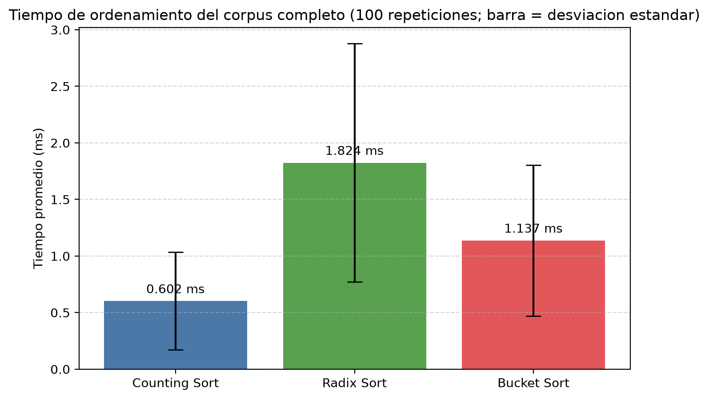
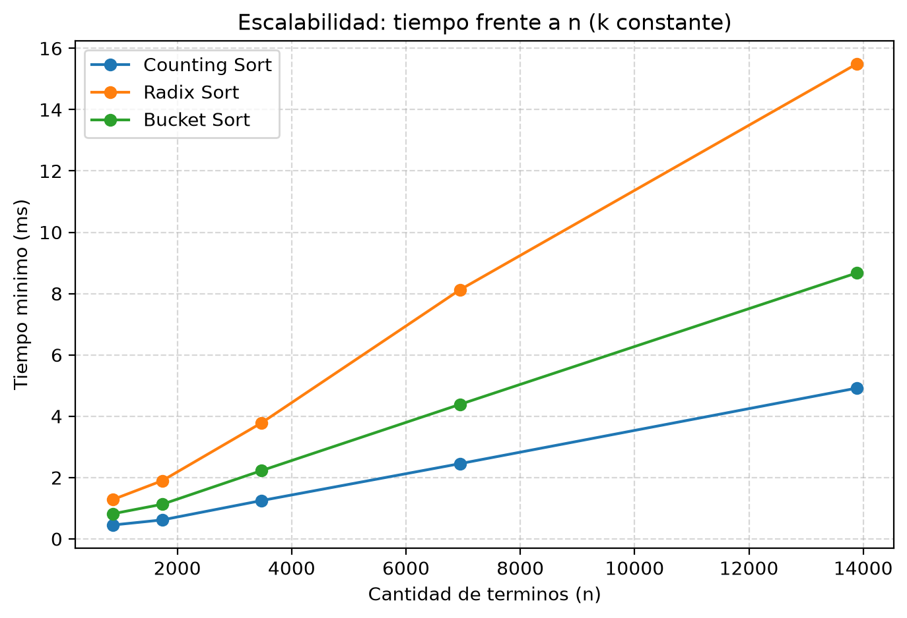

# Ranking de Términos mediante Algoritmos de Ordenamiento sin Comparaciones

**Universidad del Quindío · Programa de Ingeniería de Sistemas y Computación**
**Análisis de Algoritmos — Seguimiento 2026-2**

**Equipo:** Daniel Josué Narváez Hincapié · Camilo Alberto Ospina
**Fecha de entrega:** 26 de octubre de 2026

---

## 1. Objetivo

A partir del preprocesamiento de los abstracts del corpus, generar el listado de los términos más frecuentes de los 20 artículos ordenado de mayor a menor frecuencia, usando tres algoritmos que no se basan en comparaciones directas entre elementos: **Counting Sort**, **Radix Sort** y **Bucket Sort**. Para cada uno se presenta:

- la fundamentación teórica de su complejidad O(n + k) u O(n) (sección 4);
- la medición empírica de sus tiempos de ejecución en milisegundos sobre el corpus completo (sección 6);
- la validación de resultados con los 15 términos más frecuentes obtenidos por cada algoritmo (sección 7).

## 2. Datos de entrada: la lista de frecuencias

El seguimiento reutiliza el preprocesamiento del Requerimiento 1 (`src/preprocessing.py`). Cada abstract se pasó a minúsculas, se tokenizó, se eliminaron la puntuación, los números y las *stopwords* en inglés, y cada token se lematizó. El resultado está en `data/corpus_preprocesado.json`.

Sobre ese corpus, `src/ordenamiento/frecuencias.py` cuenta cuántas veces aparece cada término en los 20 abstracts. Se usa la definición de frecuencia de término de Manning, Raghavan y Schütze (2008, sec. 6.2), sumada sobre todo el corpus. El módulo **solo cuenta**: no ordena, porque ordenar es la tarea de los tres algoritmos.

| Medida | Valor |
|---|---|
| Tokens en el corpus | 2.532 |
| Términos distintos (**n**, elementos a ordenar) | 868 |
| Frecuencia máxima (**k**, rango de las claves) | 86 (término `ai`) |
| Términos que aparecen una sola vez | 484 (56 %) |

**Criterio de desempate.** La lista se entrega en el orden en que cada término aparece por primera vez en el corpus (artículo 1 a 20, token por token). Los tres algoritmos implementados son **estables**: conservan el orden relativo de los elementos con la misma clave. Por eso, dos términos con la misma frecuencia quedan en el ranking en el orden en que aparecieron por primera vez, y los tres algoritmos producen exactamente el mismo resultado.

**Orden descendente.** Los tres algoritmos ordenan de forma ascendente por una clave entera. Para obtener el ranking de mayor a menor frecuencia sin perder la estabilidad, se ordena por la clave transformada:

$$\text{clave}(t) = k - \text{frecuencia}(t)$$

El término más frecuente recibe la clave 0 y queda primero. Invertir el resultado de un ordenamiento ascendente también daría el orden descendente, pero invertiría el orden de los empates y rompería el criterio de desempate.

## 3. La cota inferior de los ordenamientos por comparación

Un algoritmo de ordenamiento **por comparación** solo obtiene información sobre los elementos comparándolos entre sí (¿*a* ≤ *b*?). Insertion Sort, Merge Sort, Heapsort y Quicksort son de este tipo. Para ellos se demuestra una cota inferior (Cormen et al., 2022, sec. 8.1, Teorema 8.1):

> Todo algoritmo de ordenamiento por comparación necesita Ω(*n* log *n*) comparaciones en el peor caso.

**Demostración (modelo del árbol de decisión).** Cualquier algoritmo por comparación se puede representar como un árbol binario de decisión: cada nodo interno es una comparación entre dos elementos y cada hoja es una permutación de la entrada, el orden final. Para ordenar correctamente cualquier entrada, el árbol debe tener al menos una hoja por cada una de las *n*! permutaciones posibles. Un árbol binario de altura *h* tiene a lo sumo 2^*h* hojas, así que:

$$2^h \ge n! \quad\Longrightarrow\quad h \ge \log_2(n!) = \Omega(n \log n)$$

La última igualdad se sigue de la aproximación de Stirling. La altura *h* es el número de comparaciones en el peor caso.

**Aplicado a este corpus:** con *n* = 868 términos, cualquier ordenamiento por comparación necesita en el peor caso al menos ⌈log₂(868!)⌉ ≈ **7.227 comparaciones** (*n* log₂ *n* ≈ 8.473).

**Por qué los tres algoritmos del seguimiento no están sujetos a esta cota.** La demostración solo vale para algoritmos que obtienen información **exclusivamente comparando** elementos. Counting Sort, Radix Sort y Bucket Sort nunca comparan dos elementos entre sí: usan el **valor** de la clave directamente como índice de un arreglo (Counting Sort), extraen sus dígitos (Radix Sort) o calculan con él a qué cubeta pertenece (Bucket Sort). Para hacerlo necesitan un supuesto adicional sobre los datos: que las claves sean **enteros en un rango acotado** 0..*k*. Con ese supuesto salen del modelo del árbol de decisión, y la cota Ω(*n* log *n*) ya no les aplica. Las frecuencias de términos cumplen el supuesto: son enteros entre 1 y 86.

## 4. Fundamentación teórica de cada algoritmo

Para ilustrar cada algoritmo se usa un ejemplo pequeño con términos y frecuencias reales del corpus.

### 4.1 Counting Sort — O(n + k)

**Fuentes:** Cormen et al. (2022, sec. 8.2); Knuth (1998, sec. 5.2), que atribuye la idea a Seward (1954).
**Implementación:** `src/ordenamiento/counting_sort.py`

**Procedimiento**, para *n* elementos con claves enteras en 0..*k*:

1. **Contar:** recorrer los *n* elementos y acumular en `conteo[v]` cuántos tienen la clave *v*.
2. **Acumular:** recorrer las *k* + 1 claves haciendo `conteo[v] += conteo[v − 1]`. Ahora `conteo[v]` es la cantidad de elementos con clave ≤ *v*, que es la posición final del último elemento con clave *v*.
3. **Colocar:** recorrer la entrada **de atrás hacia adelante**; cada elemento con clave *v* va a la posición `conteo[v] − 1`, y `conteo[v]` se decrementa.

**Ejemplo** (*k* = 3), con la clave *k* − frecuencia:

| Entrada | ai | data | model | tool | review | bias |
|---|---|---|---|---|---|---|
| Frecuencia | 3 | 1 | 2 | 1 | 3 | 2 |
| Clave = 3 − frecuencia | 0 | 2 | 1 | 2 | 0 | 1 |

- Paso 1, conteos de las claves 0, 1, 2 y 3: `[2, 2, 2, 0]`.
- Paso 2, conteos acumulados: `[2, 4, 6, 6]`.
- Paso 3, de atrás hacia adelante: *bias* (clave 1) va a la posición 3; *review* (0) a la 1; *tool* (2) a la 5; *model* (1) a la 2; *data* (2) a la 4; *ai* (0) a la 0.
- **Resultado:** ai, review, model, bias, data, tool. Está ordenado de mayor a menor frecuencia, y los empates (*ai*/*review*, *model*/*bias*, *data*/*tool*) conservan su orden de entrada.

**Complejidad.** El paso 1 recorre los *n* elementos, el paso 2 recorre las *k* + 1 claves y el paso 3 vuelve a recorrer los *n* elementos:

$$T(n, k) = \Theta(n) + \Theta(k) + \Theta(n) = \Theta(n + k)$$

La memoria adicional es Θ(*n* + *k*): el arreglo de conteos y el de salida. Si *k* = O(*n*), el tiempo es O(*n*). En el corpus, *k* = 86 es mucho menor que *n* = 868, así que el término *k* es despreciable y el algoritmo trabaja prácticamente en tiempo lineal en *n*: unas *n* + *k* = 954 operaciones por recorrido, frente a las ≈ 7.227 comparaciones mínimas de un ordenamiento por comparación.

**Estabilidad.** Al recorrer la entrada de atrás hacia adelante, el último elemento con clave *v* ocupa la última posición disponible para *v*, el penúltimo la anterior, y así sucesivamente. Los empates quedan en su orden original.

### 4.2 Radix Sort — O(d · (n + b)) = O(n)

**Fuentes:** Cormen et al. (2022, sec. 8.3, Lema 8.3); Knuth (1998, sec. 5.2.5).
**Implementación:** `src/ordenamiento/radix_sort.py`

**Procedimiento (LSD, del dígito menos significativo al más significativo).** Una clave de *d* dígitos en base *b* se ordena con *d* pasadas. En la pasada *i* (0 = unidades, 1 = decenas, …) se ordenan los elementos solo por su *i*-ésimo dígito, $\lfloor v / b^i \rfloor \bmod b$, con un ordenamiento **estable**. Aquí ese ordenamiento es Counting Sort con claves en 0..*b* − 1.

**Por qué es correcto** (Cormen et al., 2022, Lema 8.3; por inducción sobre *i*): después de la pasada *i*, los elementos están ordenados por sus *i* + 1 dígitos menos significativos. En la pasada *i*, los elementos con distinto dígito *i* quedan ordenados por ese dígito, y los que tienen el mismo dígito conservan, gracias a la estabilidad, el orden de la pasada anterior, que ya los ordenaba por los dígitos inferiores. Sin la estabilidad del ordenamiento interno, el algoritmo no funcionaría.

**Ejemplo** (*k* = 86, base 10, 2 dígitos):

| Término | ai | use | high | study | aied |
|---|---|---|---|---|---|
| Frecuencia | 86 | 25 | 16 | 36 | 38 |
| Clave = 86 − frecuencia | 00 | 61 | 70 | 50 | 48 |

- **Pasada 1, por unidades** (0, 1, 0, 0, 8): ai (00), high (70), study (50), use (61), aied (48).
- **Pasada 2, por decenas** (0, 7, 5, 6, 4), conservando el orden de la pasada 1 en los empates: ai (00), aied (48), study (50), use (61), high (70).
- **Resultado:** ai 86, aied 38, study 36, use 25, high 16.

**Complejidad.** *d* pasadas de Counting Sort, cada una Θ(*n* + *b*):

$$T(n) = \Theta(d \cdot (n + b))$$

con *d* = ⌊log_*b* *k*⌋ + 1 dígitos. Con *b* = 10 fijo y *d* constante, el tiempo es O(*n*). En el corpus, *k* = 86 tiene *d* = 2 dígitos: 2 pasadas de Θ(868 + 10), unas 1.756 operaciones. La memoria adicional es Θ(*n* + *b*).

Radix Sort es útil cuando el rango de claves *k* es muy grande, porque Counting Sort necesitaría un arreglo de *k* + 1 posiciones, mientras que Radix Sort solo necesita *b* posiciones por pasada. Con *k* = 86 esa ventaja no aplica, y Radix Sort hace el doble de recorridos que Counting Sort.

### 4.3 Bucket Sort — O(n + k)

**Fuentes:** Cormen et al. (2022, sec. 8.4); Isaac y Singleton (1956).
**Implementación:** `src/ordenamiento/bucket_sort.py`

**Procedimiento:**

1. **Distribuir:** con claves en 0..*k* y *m* cubetas de ancho $w = \lceil (k+1)/m \rceil$, la clave *v* va a la cubeta ⌊*v* / *w*⌋. Agregar a una cubeta conserva el orden de llegada.
2. **Ordenar cada cubeta:** la cubeta *i* contiene claves en [*i*·*w*, *i*·*w* + *w* − 1], y se ordena con Counting Sort usando la clave local *v* − *i*·*w*, que está en 0..*w* − 1.
3. **Concatenar** las cubetas de la 0 a la *m* − 1. Como cada cubeta cubre un rango de claves menor que el de la siguiente, el resultado queda ordenado sin comparar elementos de cubetas distintas.

**Diferencia con la versión de Cormen et al.** El libro ordena cada cubeta con Insertion Sort, que **sí compara** elementos. En este proyecto se usa Counting Sort, así que el algoritmo completo no hace ninguna comparación entre elementos, como pide el seguimiento. Como la distribución conserva el orden de llegada y Counting Sort es estable, Bucket Sort también es estable.

**Número de cubetas.** Se usa *m* = ⌈√(*k* + 1)⌉, que equilibra la cantidad de cubetas con el tamaño del arreglo de conteo de cada una. En el corpus, *k* = 86 da *m* = 10 cubetas de ancho *w* = 9.

**Ejemplo** (*k* = 86, *m* = 10, *w* = 9), con las claves del ejemplo de Radix Sort:

- **Distribución:** ai (00) → cubeta 0; aied (48) y study (50) → cubeta 5; use (61) → cubeta 6; high (70) → cubeta 7.
- **Ordenar la cubeta 5** (claves 45 a 53) con las claves locales study: 50 − 45 = 5 y aied: 48 − 45 = 3. Queda aied, study.
- **Concatenar:** ai, aied, study, use, high. Es el mismo resultado que con Radix Sort.

**Complejidad.** La distribución es Θ(*n*). La cubeta *i*, con *n*ᵢ elementos, se ordena en Θ(*n*ᵢ + *w*). La concatenación es Θ(*n*). En total:

$$T(n, k) = \Theta\!\left(n + \sum_{i=0}^{m-1} (n_i + w)\right) = \Theta(n + m \cdot w) = \Theta(n + k + m)$$

porque *m*·*w* < *k* + 1 + *m*. Como *m* ≤ *k* + 1, el tiempo es O(*n* + *k*) **en el peor caso**, sin importar cómo se repartan los elementos entre las cubetas. En la versión del libro, con Insertion Sort, el tiempo es O(*n*) solo **en promedio** y bajo el supuesto de claves uniformes; en el peor caso, con todos los elementos en una cubeta, es O(*n*²).

**La distribución de las frecuencias no es uniforme.** Las frecuencias de palabras en un texto siguen aproximadamente la ley de Zipf (Manning et al., 2008, sec. 5.1.2): pocos términos son muy frecuentes y la gran mayoría aparece una o dos veces. En el corpus, la ocupación de las 10 cubetas fue:

| Frecuencias de la cubeta | Términos | % |
|---|---|---|
| 78–86 | 1 | 0,1 % |
| 69–77 | 0 | 0,0 % |
| 60–68 | 0 | 0,0 % |
| 51–59 | 1 | 0,1 % |
| 42–50 | 2 | 0,2 % |
| 33–41 | 4 | 0,5 % |
| 24–32 | 2 | 0,2 % |
| 15–23 | 10 | 1,2 % |
| 6–14 | 79 | 9,1 % |
| 1–5 | 769 | 88,6 % |

La última cubeta cubre en teoría las frecuencias 0 a 5, pero ningún término tiene frecuencia 0, así que en la práctica contiene las frecuencias 1 a 5. El 88,6 % de los términos cae en esa sola cubeta, y dos cubetas quedan vacías. Con Insertion Sort, esa concentración haría que la cubeta de 769 términos dominara el tiempo total, con un costo cuadrático en el peor caso. Con Counting Sort como ordenamiento interno, la complejidad sigue siendo lineal, pero el reparto en cubetas no aporta ventaja: es trabajo adicional sobre lo que Counting Sort haría directamente.

### 4.4 Resumen teórico

| Algoritmo | Tiempo | Memoria adicional | Estable | Operaciones aproximadas en el corpus |
|---|---|---|---|---|
| Counting Sort | Θ(*n* + *k*) | Θ(*n* + *k*) | Sí | *n* + *k* = 954 |
| Radix Sort (LSD, base 10) | Θ(*d* · (*n* + *b*)) | Θ(*n* + *b*) | Sí | 2 · (868 + 10) = 1.756 |
| Bucket Sort (cubetas con Counting Sort) | Θ(*n* + *k* + *m*) | Θ(*n* + *m* + *w*) | Sí | *n* + *m*·*w* = 958 |
| *Cota para ordenamientos por comparación* | Ω(*n* log *n*) | — | — | ≥ 7.227 comparaciones |

## 5. Implementación

| Archivo | Contenido |
|---|---|
| `src/ordenamiento/frecuencias.py` | Lista de pares (término, frecuencia), en orden de primera aparición |
| `src/ordenamiento/counting_sort.py` | `counting_sort(elementos, clave, k)`, genérico y estable, y el ranking por frecuencia |
| `src/ordenamiento/radix_sort.py` | `radix_sort(elementos, clave, valor_maximo, base)`, que usa `counting_sort` en cada dígito |
| `src/ordenamiento/bucket_sort.py` | `bucket_sort(elementos, clave, k, num_cubetas)`, que usa `counting_sort` dentro de cada cubeta |
| `src/ordenamiento/comparacion.py` | Validación, medición de tiempos y escalabilidad |

Los algoritmos están implementados con listas y ciclos de Python. En ninguno se usan `sorted()`, `list.sort()` ni otra función de ordenamiento del lenguaje; `sorted()` aparece solo en las pruebas unitarias, como referencia para verificar resultados. Cada módulo cita en su encabezado la fuente del algoritmo que implementa.

**Pruebas unitarias** (59 en total): frecuencias (5), Counting Sort (14), Radix Sort (20) y Bucket Sort (20). Incluyen los ejemplos de las figuras 8.2 (Counting Sort) y 8.3 (Radix Sort) de Cormen et al., la verificación de estabilidad, la comparación con un ordenamiento de referencia en datos aleatorios y una prueba que confirma que Radix Sort hace exactamente una pasada por dígito.

## 6. Medición empírica

### 6.1 Metodología

Los tiempos se midieron con `src/ordenamiento/comparacion.py`:

- **Reloj:** `time.perf_counter()`, el de mayor resolución disponible en Python.
- **Calentamiento:** 5 ejecuciones previas de cada algoritmo que no se cuentan, porque la primera ejecución suele ser más lenta por la carga del código.
- **Repeticiones:** 100 por algoritmo, **alternando** los tres en cada repetición (Counting, Radix, Bucket, Counting, …). Así, una variación momentánea del equipo afecta a los tres por igual y no solo al que se estaba midiendo.
- **Qué se mide:** solo la llamada al ordenamiento, sobre la lista de frecuencias del corpus completo (*n* = 868). La lectura del corpus y el conteo quedan fuera de la medición.
- **Qué se reporta:** el promedio, la desviación estándar y el mínimo. El mínimo es la medición menos afectada por interrupciones del sistema operativo.

### 6.2 Tiempos sobre el corpus completo

| Algoritmo | Promedio (ms) | Desviación estándar (ms) | Mínimo (ms) |
|---|---|---|---|
| Counting Sort | 0,6018 | 0,4315 | 0,3051 |
| Radix Sort | 1,8244 | 1,0521 | 0,9416 |
| Bucket Sort | 1,1370 | 0,6662 | 0,5686 |

Los tres algoritmos ordenan los 868 términos en menos de 2 ms. El orden de rapidez coincide con el número de operaciones estimado en la sección 4.4:

- **Counting Sort es el más rápido:** recorre la lista dos veces y el arreglo de conteos una vez.
- **Bucket Sort tarda cerca del doble** (1,9 veces, comparando mínimos): además de un Counting Sort por cubeta, reparte los elementos y concatena las cubetas. Con la distribución de Zipf de la sección 4.3, ese reparto no reduce el trabajo.
- **Radix Sort tarda unas 3 veces más** que Counting Sort: hace 2 pasadas completas de Counting Sort y, en cada una, calcula el dígito de cada clave con una potencia, una división entera y un módulo.

Los tres son lineales, pero difieren en la **constante** que multiplica a *n*. La notación asintótica describe cómo crece el tiempo, no cuánto vale.

La desviación estándar es alta (entre el 58 % y el 72 % del promedio). Con tiempos de menos de 2 ms, cualquier interrupción del sistema operativo pesa mucho; por eso se reportan también los mínimos, y la comparación entre algoritmos se mantiene igual con ambas medidas.

### 6.3 Escalabilidad: contraste empírico de O(n)

Para contrastar la complejidad teórica, se midió cada algoritmo sobre listas de tamaño creciente. La lista de frecuencias se repitió 1, 2, 4, 8 y 16 veces, renombrando los términos para que fueran distintos, de modo que la distribución de frecuencias y *k* = 86 se mantienen constantes y **solo cambia *n***. Se reporta el tiempo mínimo de 30 repeticiones:

| *n* | Counting Sort (ms) | Radix Sort (ms) | Bucket Sort (ms) | µs por término (Counting / Radix / Bucket) |
|---|---|---|---|---|
| 868 | 0,4525 | 1,2821 | 0,8190 | 0,521 / 1,477 / 0,944 |
| 1.736 | 0,6195 | 1,8989 | 1,1298 | 0,357 / 1,094 / 0,651 |
| 3.472 | 1,2500 | 3,7836 | 2,2268 | 0,360 / 1,090 / 0,641 |
| 6.944 | 2,4539 | 8,1236 | 4,3864 | 0,353 / 1,170 / 0,632 |
| 13.888 | 4,9179 | 15,4923 | 8,6734 | 0,354 / 1,116 / 0,625 |

**Desde *n* = 1.736, cada vez que *n* se duplica el tiempo se duplica**, y el tiempo por término se mantiene prácticamente constante: unos 0,35 µs en Counting Sort, 1,1 µs en Radix Sort y 0,63 µs en Bucket Sort. Esa es la firma empírica de un algoritmo lineal. Con *k* constante, Θ(*n* + *k*) se comporta como Θ(*n*). El primer punto (*n* = 868) tiene un costo por término algo mayor porque, con listas pequeñas, pesan más los costos fijos, como crear los arreglos de conteo y las cubetas. Un algoritmo Θ(*n* log *n*) mostraría, en cambio, un costo por término que crece lentamente con *n*.

## 7. Validación de resultados: los 15 términos más frecuentes

Los tres algoritmos producen **exactamente el mismo ranking completo** de los 868 términos. `comparacion.py` lo verifica en cada ejecución, y las pruebas unitarias lo comprueban también en listas aleatorias. Es el resultado esperado: los tres son estables y reciben la misma lista con el mismo criterio de desempate.

| # | Counting Sort | Radix Sort | Bucket Sort | Frecuencia |
|---|---|---|---|---|
| 1 | ai | ai | ai | 86 |
| 2 | education | education | education | 57 |
| 3 | review | review | review | 48 |
| 4 | research | research | research | 46 |
| 5 | aied | aied | aied | 38 |
| 6 | assessment | assessment | assessment | 37 |
| 7 | study | study | study | 36 |
| 8 | educational | educational | educational | 33 |
| 9 | learn | learn | learn | 31 |
| 10 | use | use | use | 25 |
| 11 | intelligence | intelligence | intelligence | 23 |
| 12 | artificial | artificial | artificial | 22 |
| 13 | technology | technology | technology | 21 |
| 14 | application | application | application | 18 |
| 15 | high | high | high | 16 |

El ranking refleja el dominio del corpus: la inteligencia artificial (`ai`, `artificial`, `intelligence`, `aied`) aplicada a la educación (`education`, `educational`, `learn`, `assessment`), en artículos que en su mayoría son revisiones de literatura (`review`, `research`, `study`). En el top 15 no hay empates de frecuencia, así que el criterio de desempate no interviene. Sí interviene en el resto del ranking, donde cientos de términos comparten frecuencia 1 o 2.

## 8. Conclusiones

1. Counting Sort, Radix Sort y Bucket Sort ordenan sin comparar elementos entre sí: usan el valor de la clave como índice, sus dígitos o su rango. Por eso no están sujetos a la cota Ω(*n* log *n*) de los ordenamientos por comparación, y logran tiempo Θ(*n* + *k*), Θ(*d*·(*n* + *b*)) y Θ(*n* + *k* + *m*), lineales en *n* cuando *k*, *d* y *m* están acotados. El precio es un supuesto sobre los datos: claves enteras en un rango conocido, que las frecuencias de términos cumplen.
2. La medición empírica confirma la complejidad lineal: con *k* fijo, el tiempo de los tres crece proporcionalmente a *n*, con un costo por término constante.
3. Para este problema, **Counting Sort es el más adecuado**: el rango de claves es pequeño (*k* = 86 frente a *n* = 868) y es el más rápido. Radix Sort aporta ventaja cuando el rango de claves es muy grande, que no es el caso. Bucket Sort no se beneficia del reparto en cubetas, porque las frecuencias siguen la ley de Zipf y casi todos los términos caen en la misma cubeta.
4. La estabilidad no es un detalle: es la que permite que Radix Sort sea correcto y que los tres algoritmos produzcan exactamente el mismo ranking, con un criterio de desempate definido.

## 9. Limitaciones

- Los tiempos dependen del equipo y varían entre ejecuciones, por eso se reportan promedio, desviación estándar y mínimo. Deben leerse como comparación entre los tres algoritmos en el mismo equipo, no como valores absolutos.
- Las implementaciones están escritas en Python puro para que su funcionamiento sea transparente, como exige el proyecto. No se compararon con las funciones de ordenamiento del lenguaje, implementadas en C, porque esa comparación mediría sobre todo la diferencia entre los lenguajes y no la de los algoritmos.
- El experimento de escalabilidad usa listas sintéticas construidas repitiendo la del corpus: conservan la distribución real de frecuencias, pero no son textos reales.

## 10. Declaración de uso de IA generativa

En la elaboración de este seguimiento se usó un asistente de IA generativa (Claude, de Anthropic) como apoyo para revisar y corregir el código, proponer pruebas unitarias y redactar borradores de la documentación. El equipo definió las tareas, ejecutó el código y las pruebas en su entorno, verificó los resultados contra las fuentes citadas y tomó las decisiones de diseño. Los tiempos reportados corresponden a ejecuciones en el equipo de los integrantes.

## 11. Referencias

- Cormen, T. H., Leiserson, C. E., Rivest, R. L. y Stein, C. (2022). *Introduction to Algorithms* (4.ª ed.). MIT Press. Capítulo 8: "Sorting in Linear Time" (sec. 8.1, cota inferior; 8.2, Counting Sort; 8.3, Radix Sort; 8.4, Bucket Sort).
- Isaac, E. J. y Singleton, R. C. (1956). Sorting by address calculation. *Journal of the ACM*, 3(3), 169–174.
- Knuth, D. E. (1998). *The Art of Computer Programming, Vol. 3: Sorting and Searching* (2.ª ed.). Addison-Wesley. Sección 5.2 (incluida 5.2.5, "Sorting by distribution").
- Manning, C. D., Raghavan, P. y Schütze, H. (2008). *Introduction to Information Retrieval*. Cambridge University Press. Sec. 5.1.2 (ley de Zipf) y sec. 6.2 (frecuencia de término).
- Seward, H. H. (1954). *Information sorting in the application of electronic digital computers to business operations* (tesis de maestría). Massachusetts Institute of Technology.
